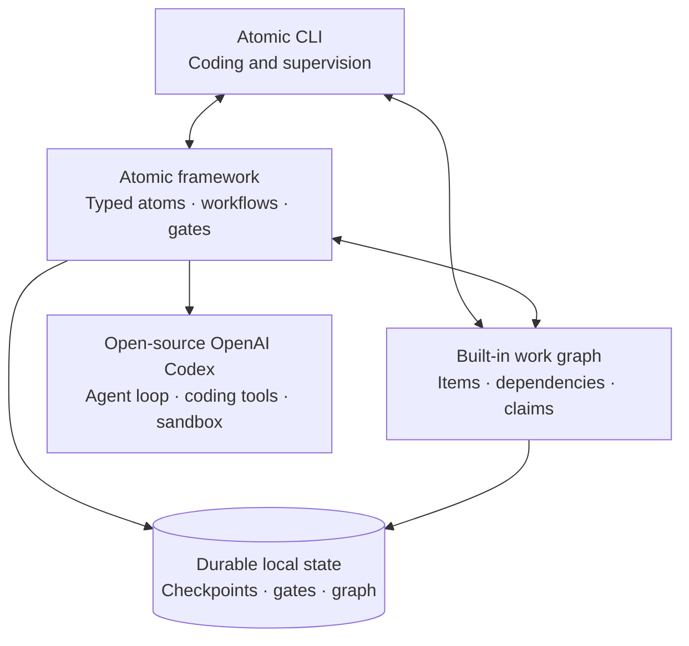

# Atomic

**A coding agent you can work with. A framework for work you want to repeat.**

Atomic is built on **OpenAI Codex, the open-source coding-agent project** at
[openai/codex](https://github.com/openai/codex). Its runtime and terminal-client
source provide the foundation embedded in Atomic. When these docs say **Codex**,
that is the project they mean.

The **planned v0.5 interactive client** offers a familiar Codex-style coding
workflow: open a project, ask it to build an app or fix a bug, review its changes
and run your tests. No atom or workflow definition is needed for that path.
The **v0.1 target starts with file-defined atoms and durable workflows**.

When a task becomes repeatable, give it a typed contract, compose it with other
tasks and let Atomic run the workflow durably. You can watch, answer, steer and
take over from the same CLI.

> Documentation draft: these pages describe the intended product experience.
> This repository does not yet ship an Atomic runtime. See
> [availability](reference/availability.md) for the planned delivery stages.

## Start where you are

| You want to… | Start here |
| --- | --- |
| Build or change an app with an agent | [CLI quickstart](getting-started/quickstart.md) |
| Turn a useful task into a reusable agent | [Your first atom](getting-started/first-atom.md) |
| Coordinate several steps with approval and recovery | [Your first workflow](getting-started/first-workflow.md) |
| Understand how the coding agent and framework fit together | [The Atomic mental model](concepts/mental-model.md) |

## Open-source OpenAI Codex underneath, Atomic on top

Codex supplies the coding agent: its agent loop, conversations, shell and patch
tools, model access and sandbox. Atomic builds on that foundation with typed
atoms, durable workflows, a shared work graph, approval gates and live supervision.
The terminal keeps the Codex coding experience and adds controls for that work.

The work graph connects the terminal to the framework: you inspect ready,
blocked and claimed items; workflows claim ready work and record results; agents
receive the relevant item context and use scoped tools to propose follow-ups or
exchange messages. An item links to its run and agent thread, so you can move
from the plan to the live coding work.

Atomic implements this beads-inspired graph as a built-in component. It shares
Atomic's durable storage and needs no separate beads installation. Ordinary
coding can still start directly in the Codex experience. Read
[the architecture](concepts/architecture.md#the-work-graph-connects-the-terminal-and-framework)
for the work loop and component boundaries. Local run inspection is built in;
[OpenTelemetry export](operations/observability.md) to Datadog or another compatible
backend is optional.

## One product, two ways to work

In the **v0.5 target**, use Atomic as your everyday coding agent in the place you
would normally open Codex or Claude Code. You do not have to define an atom or a workflow to start
coding.

Atomic is also a general-purpose agent framework. An **atom** is a focused task
with typed input and output. A **workflow** coordinates atoms, deterministic work
and approval gates. That can mean a code migration, an order report, an incident
investigation or a support draft.

The CLI connects both experiences. It is an interactive workspace for the person
and a control surface for running agents. You can direct an agent; an agent can
ask you a question, report a blocker or start an allowed workflow. Human approval
and policy remain under your control.

## Grow into the framework

In v0.1, start with [one small atom](getting-started/first-atom.md). In v0.5,
you can also start with a prompt and add an atom when a task becomes repeatable. Add a
workflow when order, retries or approval matter. Atomic includes durable execution:
a workflow records completed steps and can recover after its process restarts.
You do not need to deploy a workflow service to try it locally.

Atomic's work graph draws from beads; its typed content and authoring model draw
from Astro; its explainable defaults draw from Spring Boot. Those ideas serve one
purpose: start with little configuration, then make the work explicit as it grows.
Read [design principles](concepts/design-principles.md) when you want the background.

## Explore the docs

- **Get started:** [installation](getting-started/installation.md),
  [subscriptions and authentication](getting-started/authentication.md),
  [CLI quickstart](getting-started/quickstart.md),
  [first atom](getting-started/first-atom.md),
  [first workflow](getting-started/first-workflow.md).
- **Understand Atomic:** [mental model](concepts/mental-model.md),
  [architecture](concepts/architecture.md),
  [atoms and workflows](concepts/atoms-and-workflows.md),
  [durable execution](concepts/durable-execution.md).
- **Use Atomic:** [coding](guides/coding-with-atomic.md),
  [controlling agents](guides/controlling-agents.md),
  [project structure](guides/project-structure.md),
  [testing](guides/testing-and-evals.md),
  [template tags](guides/template-tags.md),
  [diagrams](guides/diagrams.md),
  [tools and integrations](guides/tools-and-integrations.md),
  [code and cloud SDKs](guides/scripts-and-cloud-sdks.md),
  [how atom code is run and confined](guides/atom-code-runtime.md),
  [Slack](guides/slack.md), [web search](guides/web-search.md),
  [security and permissions](guides/security-and-permissions.md).
- **Look things up:** [CLI](reference/cli.md),
  [atom files](reference/atom-files.md),
  [workflow files](reference/workflow-files.md),
  [configuration](reference/configuration.md),
  [project manifest](reference/manifest.md), [budgets](reference/budgets.md),
  [eval cases](reference/eval-cases.md), [glossary](reference/glossary.md),
  [troubleshooting](reference/troubleshooting.md).
- **Go further:** [examples](examples/README.md),
  [local and team operation](operations/running-atomic.md),
  [observability](operations/observability.md),
  [availability](reference/availability.md).

[Full navigation](SUMMARY.md)
