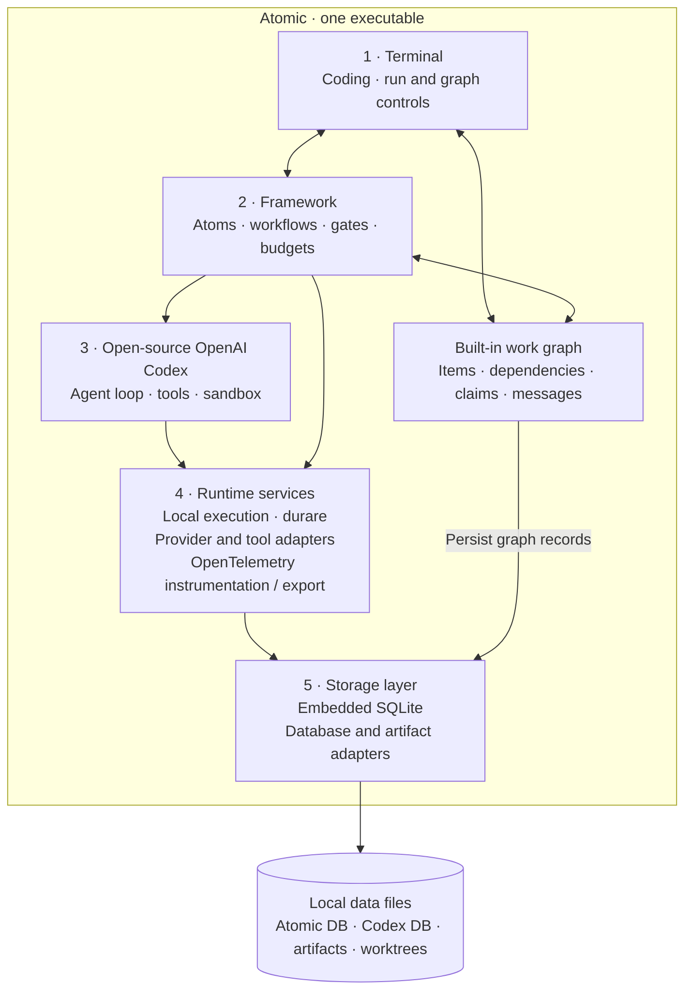

# Architecture: Atomic on Codex

**Atomic is a single executable containing the CLI, agent framework, built-in work
graph, durable execution engine, OpenTelemetry observability and the open-source
OpenAI Codex runtime.** It also includes the local execution backend, SQLite engine
and storage/integration adapters. These are components of one application, not
services you install individually.

The [Codex foundation](../README.md#open-source-openai-codex-underneath-atomic-on-top)
is OpenAI's open-source agent/CLI code, published under the
[Apache-2.0 license](https://github.com/openai/codex/blob/237d8b104ed06ae46c5ed9a54693672dea21856c/LICENSE). Model
inference and hosted search use configured services; they are not embedded model
weights or a local search index.

In **v0.1**, use `atomic run` to start reusable work and `atomic runs resume` or
local `atomic serve` to recover it. The **v0.5** client adds `atomic` for immediate
coding and live supervision. Local persistence uses SQLite files and an artifact
directory without a database server. Run inspection needs no observability backend;
optional telemetry export connects to Datadog or other compatible providers.

Model inference uses your configured provider or local model endpoint. Slack and
other connected services remain external systems. The single binary contains the
clients and adapters that connect to them; the diagram separates those dependencies
from the components packaged inside Atomic.

## The stack

The outer box is the Atomic executable. Read from terminal to framework, embedded
Codex and runtime services. The work graph connects to both terminal and framework
and persists through the embedded SQLite/storage layer. Optional observability
backends and model/service endpoints remain external dependencies, described below.
Detailed telemetry flow has its [own diagram](../operations/observability.md#follow-the-telemetry-path).

| Outside the executable | Role |
| --- | --- |
| Hosted or local model endpoint | Model inference; native hosted search where supported |
| Slack, MCP servers and HTTP APIs | Separately authorized service integrations |
| Optional Collector and compatible OTEL backend | Telemetry routing and viewing; Datadog is one example |
| Deno, from v0.7 | Runs the TypeScript that atoms carry, in its own process. Atomic downloads a pinned, checksum-verified copy when a project first needs it |

The storage layer groups access paths for readability. Atomic's workflow,
gate and graph records share one database; Codex owns a separate state database.
Artifacts and worktrees are files, not bytes compiled into the executable. The
terminal reaches graph persistence through the graph component's tools/API.

## One executable, several modes

| Mode | What the same binary does |
| --- | --- |
| `atomic run` / `atomic runs resume` · v0.1 | Starts new work / recovers an existing unfinished run in the foreground |
| `atomic serve` · v0.1 local | Runs the headless local runtime; team service support follows in v0.5 |
| `atomic` · v0.5 | Runs the local interactive experience, or attaches its terminal client to an existing runtime |
| `atomic runner` · later | Runs the execution role for a remote backend |

The local control plane, graph, durability engine and Codex runtime run together.
Shell commands execute in sandboxed child processes. A team deployment can run
the same executable in separate roles and use Postgres or external object storage;
those are deployment choices around the same packaged application components.
See [availability](../reference/availability.md) for the delivery stages.

## The work graph connects the terminal and framework

The graph is a built-in Atomic component inspired by beads' model of persistent,
dependency-aware work. Atomic implements it in its own runtime and storage; the
terminal and agents access it through Atomic's authorized tools and API.

| Surface | How it uses the same graph |
| --- | --- |
| Terminal | Inspect items, see what is ready or blocked, manage work and follow an item to its run and live agent thread |
| Framework | Select ready work, acquire a claim, run the assigned atom and record results or follow-ups |
| Agent thread | Receive the claimed item's criteria and relevant approved context; use allowed tools to read work, propose follow-ups and exchange messages |
| Durable store | Preserve items, dependencies, claim state and messages alongside workflow checkpoints |

A work loop ties those surfaces together:

1. You inspect or create an item in the terminal, with its acceptance criteria and
   dependencies.
2. A graph-driven workflow selects it when ready and acquires a claim before
   starting the atom.
3. The atom receives that item's context and executes in a Codex thread. The
   terminal links the item to the run and thread, so you can inspect or steer it.
4. The workflow checks the result, passes required gates and records the outcome,
   including a candidate commit or artifact. Follow-ups become linked work items.
5. Dependency changes make the next items ready; another agent or a later session
   can continue from the saved work record.

The workflow definition describes execution; the work graph describes the work
being coordinated; durare checkpoints describe saved execution progress. Codex
threads show the conversations carrying it out. Keeping those roles distinct lets
a person follow a project without reconstructing its plan from chat history.

Gate proposals and decisions remain in the gate store, with graph projections
for visibility and blocking. A graph update cannot substitute for a human-only
gate decision. Graph views and tools share state, but keep their own authorization.

The first graph experience is planned through tools and commands; the dedicated
`/graph` TUI pane comes later. A small sequential workflow or ordinary coding
session can start without graph-driven scheduling. See
[availability](../reference/availability.md) for those stages.

## What comes from open-source OpenAI Codex

The [open-source Codex project](https://github.com/openai/codex) supplies the agent
that understands a coding task, inspects the repository, edits files and runs
commands. Its runtime provides threads, the agent loop, coding tools, sandboxing,
permissions, model access and integration hooks.
The terminal client provides the basis of Atomic's interactive coding experience.
Codex also supplies native hosted web search and MCP client support. Hosted search
has a separate egress path from shell networking; external service connections
such as [Slack](../guides/slack.md) need their own authorization and integration
policy. See [web search](../guides/web-search.md).

In the v0.5 target, open a directory and launch `atomic` for ordinary coding.
Ask it to build, debug, test or explain code as you normally would. Atom and workflow
definitions become useful when you want to package or coordinate that work.

## What Atomic adds

| Component | Responsibility |
| --- | --- |
| Atoms and schema registry | Give focused tasks typed input/output contracts and check definitions |
| Workflow runtime | Compose tasks, record progress and recover unfinished runs |
| Gates | Store approval proposals and decisions independently of a live turn |
| Work graph and messages | Coordinate ready work, claims, dependencies and durable communication |
| Budgets and evals | Bound execution and evaluate reusable tasks |
| CLI supervision | Connect live agent threads to runs and expose human control over them |
| Embedded observability | Correlate Atomic/Codex activity and export traces, metrics and logs over OpenTelemetry |

The CLI connects to both ordinary coding threads and supervised workflow runs.
People can start and steer work; agents can ask questions, report progress and
use allowed workflow tools. Human-only operations retain their own authorization.

## Built-in observability, optional backends

The binary includes instrumentation and telemetry exporters. Local run records
support `atomic runs show <run-id>` without a Collector, Datadog account or trace
viewer. Those records let you inspect steps, results, usage, failures and human
actions; they remain distinct from exported telemetry.

Optional OTLP export sends traces, metrics and structured logs to an OpenTelemetry
Collector, which can route to Datadog or another compatible backend. A local
Jaeger or Langfuse setup can provide trace/agent-quality views. These backend
processes and the Collector sit outside the Atomic binary; they are optional
infrastructure, not prerequisites for local use.

Atomic joins workflow/step metadata with Codex model/tool activity using a shared
OpenTelemetry integration. Content capture is off by default. Completed-step
replay reuses the saved result without another model call or cost; actual retry
attempts remain visible. Workflow recovery relies on durable state, independently
of the observability backend.

Read [local observability and telemetry](../operations/observability.md) for the
planned first-release inspection path, local trace helper and backend routing.

## Durability belongs to Atomic

Atomic uses durare for workflow execution and checkpointing, with SQLite locally
and Postgres for teams. Workflow state and the work graph belong to Atomic's
store. Large results live in an artifact store. Codex retains its own thread and
transcript state; a conversation transcript is not a workflow checkpoint.

The framework-to-durare and storage path in the diagram is intentional: durability
is embedded in Atomic around task boundaries. It does not require Codex itself to
checkpoint every shell command. Read [durable execution](durable-execution.md) for
interrupted steps, approval persistence and external-effect recovery.

## Other atom kinds use the capabilities they need

The diagram highlights the Codex path. A lite atom calls a model provider without
a full coding thread. An exec atom runs a deterministic command in its execution
workspace. A later A2A atom delegates to an approved remote agent. Atomic still
owns their contracts, workflow progress and supervision.

Next: [CLI quickstart](../getting-started/quickstart.md),
[atoms and workflows](atoms-and-workflows.md), or
[watching and controlling agents](../guides/controlling-agents.md).
