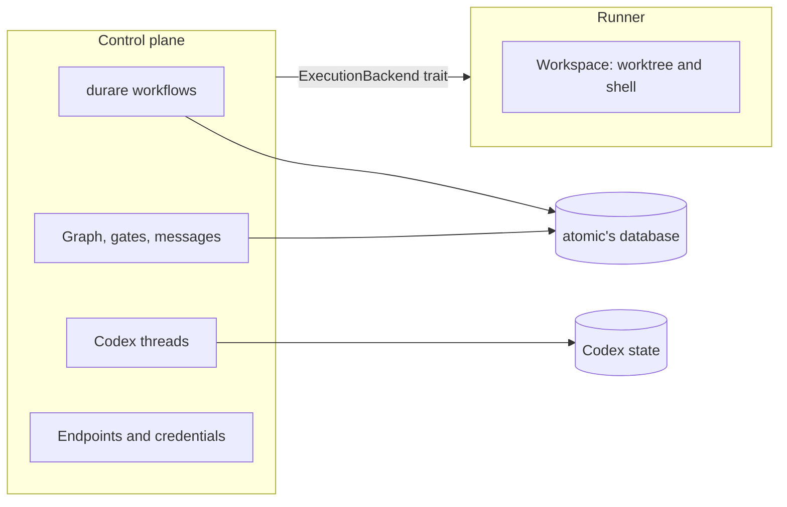

# Architecture

This page covers atomic's internals: the two roles the binary plays, the
databases it owns, the crates in its workspace and the upstream projects it
builds on. [Architecture: Atomic on Codex](../concepts/architecture.md) gives
the user-facing picture; this page is the design underneath.

atomic ships as a single executable from a single Cargo workspace. That one
binary serves as the command-line tool, the local runtime, the team server and,
in a later phase, the remote runner. Atoms execute on Codex crates. Workflows
and their checkpoints run on a fork of durare. Codex and durare share one SQLite
library at link time.

## Control plane and runners

The binary has two roles with different trust.

- The **control plane** is trusted. Workflows and checkpoints, the work graph,
  gates, the schema registry, the MCP, A2A and HTTP endpoints, the OpenAPI
  executor and the Codex runtime (with its threads and transcripts) all live
  here, and so does every credential for models and APIs.
- A **runner** is untrusted. It owns the workspace of a single atom run, meaning
  the worktree or scratch directory, the shell, the edits and the test runs, and
  it executes whatever commands the model picks.

| | Control plane (`atomic serve`) | Runner (`atomic runner`) |
| --- | --- | --- |
| Contents | Workflows, graph, gates, schemas, endpoints, Codex threads, credentials | The workspace and shell of one atom run |
| Trust | Trusted | Untrusted, because a model directs its commands |
| Placement | Inside the local process; a Postgres-backed deployment for a team | Inside the local process; elsewhere an SSH host, a pod or a sandboxed actor |
| State | Authoritative | Throwaway; a snapshot is at most a cache |

Locally the two roles run in one process. In containers, or on a platform of
sandboxed actors, they become separate processes. Either way they communicate
only through the `ExecutionBackend` trait in `atomic-exec`, so relocating a
runner leaves workflow code untouched. The backends themselves are on the
[execution backends](execution-backends.md) page.

## One process, two databases

Each of the two database files has a single owner:

- **atomic's database** is authoritative. It stores durare's workflow state
  together with the work graph, messages, gates and ledgers: a SQLite file on a
  laptop, a Postgres database for a team.
- **Codex's state database** stores thread state. atomic aims Codex's home
  directory and state database at the project's state directory, which keeps
  atom threads separate from anyone's personal Codex sessions. Correctness never
  depends on what this file contains.

Two files means two engines never contend for one SQLite writer lock. Both sit
in the per-project state directory and never in the source tree. The reason the
graph and the workflow engine share the first file is explained under
[durability](durability.md#one-database-for-workflows-and-the-graph).

## Crates

| Crate | Package | Role |
| --- | --- | --- |
| `atomic-core` | `atomic-agentic-core` | The atom contract and its Codex runtime; no other crate depends on Codex |
| `atomic-durable` | `atomic-agentic-durable` | The `DurableRuntime` trait and the adapter onto durare; no other crate names durare |
| `atomic-atoms` | `atomic-agentic-atoms` | Built-in atoms, for example the planner, implementer and reviewer |
| `atomic-graph` | `atomic-agentic-graph` | The work graph: items, edges, claims, messages and sync |
| `atomic-schema` | `atomic-agentic-schema` | The schema registry, lowering and validation |
| `atomic-exec` | `atomic-agentic-exec` | The `ExecutionBackend` trait and its implementations |
| `atomic` | `atomic-agentic` | The binary: process dispatch, workflows and the operator CLI |

Three boundaries keep changes upstream from spreading:

- **Codex is reached only through `atomic-core`.** Every Codex dependency points
  at one pinned commit, and Codex's `[patch.crates-io]` block is copied into the
  workspace verbatim, plus one atomic line for `sqlx-postgres`, with a check
  that fails if the two drift apart.
- **durare is reached only through `DurableRuntime`.** Replacing the engine would
  mean a new implementation of that trait and nothing more.
- **Runners are reached only through `ExecutionBackend`.**

Codex's process dispatch runs before anything else in `main`. On Linux the
binary launches copies of itself to act as the sandbox helper and the patch
tool, and dispatch is what routes those launches.

## Forks

atomic builds three upstream projects from forks. Each is pinned in
[`deps/forks.toml`](../../deps/forks.toml), described in
[`deps/README.md`](../../deps/README.md), and checked by
`scripts/forks-check.sh` against `Cargo.lock`.

| Fork | Base | Why |
| --- | --- | --- |
| `atomic-agentic/codex` | The upstream release tag named in [`deps/codex.toml`](../../deps/codex.toml) | Two commits in `utils/pty` make the parent-death signal best effort on systems that refuse or lack `prctl`. Codex core is unmodified |
| `atomic-agentic/durare` | An upstream durare commit | Ported to the `sqlx` line Codex uses, as described below |
| `transact-rs/sqlx` | Upstream sqlx | The fork Codex patches in for `sqlx-core` and `sqlx-sqlite`; atomic takes `sqlx-postgres` from the same fork and revision |

## The durare fork

durare is a durable-execution engine for Rust whose schema matches DBOS. The
fork exists because of linking: Codex pins exact versions of `sqlx` and
`libsqlite3-sys`, a build may contain only one crate that links `sqlite3`, and
upstream durare depends on an older `sqlx`. The fork therefore:

- **Targets Codex's `sqlx` line,** so Codex's `[patch]` block resolves both
  projects to the same patched `sqlx-core` and `sqlx-sqlite`.
- **Defaults to SQLite and puts Postgres behind a feature.** The Postgres driver,
  `sqlx-postgres`, is taken from the transact-rs `sqlx` fork at the revision
  Codex uses, because only that build matches the patched core.
- **Needs no running database to compile,** committing offline query data
  wherever queries are checked at compile time.
- **Leaves the DBOS schema alone,** so DBOS tools can still read the data and the
  fork stays easy to rebase.
- **Lets a caller add a condition to the checkpoint transaction,** the hook that
  ownership epochs rely on (see
  [run ownership](execution-backends.md#run-ownership-and-scaling)).

M0 has to prove the fork before other work depends on it.

## Crash isolation

Sharing a process has a cost: if a Codex turn aborts the process, every workflow
running in it stops too. Durability absorbs this, because after a restart each
unfinished run picks up from its most recent checkpoint. Within the process,
every atom gets its own async task, so a panic turns into a failed step instead
of killing atomic. Restarting the process itself is the job of a supervisor such
as systemd or a container restart policy. M3 covers the panic case.

## Upstream projects

| Project | Licence | What atomic uses |
| --- | --- | --- |
| [OpenAI Codex](https://github.com/openai/codex) | Apache-2.0 | Agent loop, threads, tools, sandbox, model providers, app-server and terminal client, as crates built from atomic's fork |
| [durare](https://github.com/SamuelXing/durare) | MIT OR Apache-2.0 | Durable workflows, steps, queues, timers and `send`/`recv`, through a fork |
| [beads](https://github.com/gastownhall/beads) | MIT | The work-graph model, reimplemented in Rust and credited in the third-party notices |
| [Astro](https://astro.build) | MIT | The `.astro` syntax of declarative atoms, read by the bundled compiler |
| [Deno](https://deno.com) | MIT | `deno_core` and V8 are linked into the binary today, for the isolates that run TypeScript helpers and for the Astro compiler, which atomic runs in a child process of its own; no Deno executable is needed. A managed Deno for code atoms and scripts is planned for v0.7 |
| [Agent2Agent](https://a2a-protocol.org) | Apache-2.0 | The remote-agent protocol, served and consumed |
| [Model Context Protocol](https://modelcontextprotocol.io) | MIT | Tools for models and clients, served and consumed |
| [OpenTelemetry](https://opentelemetry.io) | Apache-2.0 | Traces, metrics and logs following the GenAI semantic conventions |

atomic is licensed Apache-2.0, as Codex is. Code that is vendored or adapted
keeps its own licence and appears in the third-party notices.
