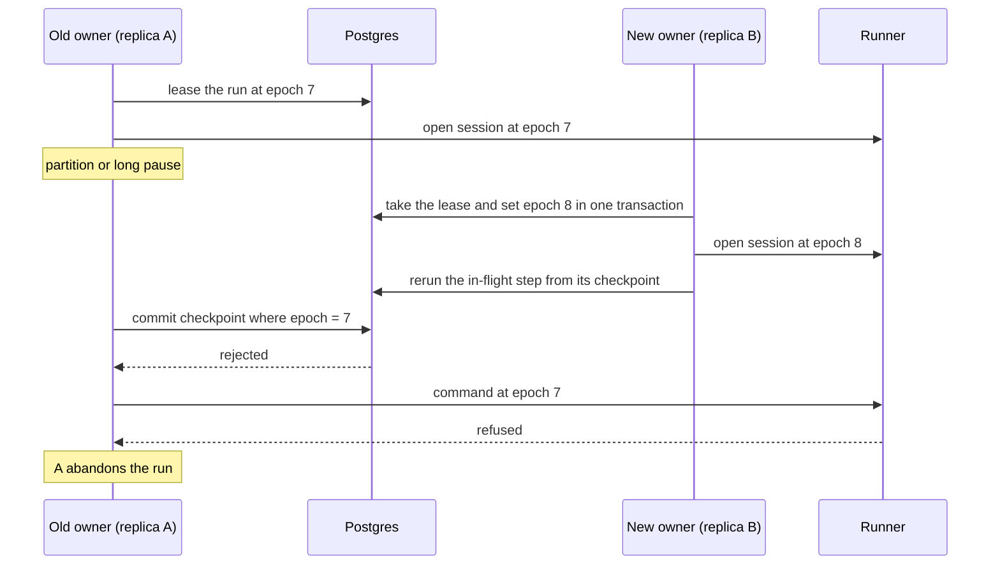

# Execution backends

atomic keeps a trusted control plane apart from untrusted runners (see
[architecture](architecture.md#control-plane-and-runners)). The only way from
one to the other is the `ExecutionBackend` trait, used even when both live in
one process, so that moving runners into containers later leaves workflow code
untouched. The long-term shape is a control plane deployed as an ordinary
trusted service on Postgres, with each atom run's untrusted work placed in a
runner that a backend chooses. Agent Substrate is the backend aimed at dense,
well-isolated placement.

## Backends

| Backend | Runner | Use | Milestone |
| --- | --- | --- | --- |
| `local` | In-process, under Codex's own sandbox | Laptop and CI | M23, v0.1 |
| `exec-server` | Codex's exec-server on an SSH host or VM | GPU boxes, locked-down build hosts | M20 |
| `kubernetes` | One pod per atom run | Clusters without Substrate | M24 |
| `substrate` | An actor for each atom run, or for a workspace that lives longer | Dense placement, strong isolation, no credentials in the sandbox | M25 |

When it connects, a backend declares whether a workspace outlives the runner
process, and the control plane schedules from that declaration (see the
[protocol rules](schemas-and-apis.md#protocol-rules-for-atomics-own-surfaces)).
`atomic runner` ends with one of a short, fixed list of exit codes, grouped by
what should happen next; any code outside the list counts as a crash. All
backends must pass the same conformance suite, which includes transcripts
captured from the local backend. For the Kubernetes backend, existing
controllers that keep warm pools of sandboxes will be assessed before atomic
writes pod management of its own.

## Run ownership and scaling

Control-plane replicas cannot be stateless, because Codex keeps threads in
memory. One replica owns each run at a time, holding a lease on it in Postgres,
and the run's Codex threads live on that replica.

- **Replica loss.** Once the lease runs out, a different replica picks up the
  run and the step that was in flight starts again from its checkpoint. Steps
  that had completed stay completed.
- **Rollouts.** A replica on its way out takes no new runs, gives in-flight
  steps until a deadline to finish, and then gives up its leases.
- **Capacity.** A replica accepts at most `max_concurrent_atoms` atoms, a number
  to be found by load testing in M24. Past that point, harness mode puts Codex
  threads inside runners and leaves replicas to orchestrate.

### Fencing stale owners

A lease alone cannot stop the previous owner. A replica that was cut
off by a partition, or simply paused for a long time, may resume convinced the
run is still its own. To guard against that, each run has an **ownership
epoch**: a counter raised in the very transaction that grants or moves the
lease. Every place where a stale owner could do harm compares epochs.

- **Checkpoints and graph changes.** Their transaction also tests the run's
  epoch. A commit from an old owner finds no matching row, and that owner drops
  the run. Postgres decides, so no clocks need to agree.
- **Runner results.** Runner sessions are opened at an epoch. After a runner has
  seen a newer epoch it rejects commands carrying an older one, and the control
  plane ignores results labelled with an old epoch.
- **Code integration.** Step branches record their epoch, the merge queue takes
  commits from the current epoch only, and landing moves the target ref with a
  compare-and-swap against the value it expects to replace.
- **External effects.** Checking the epoch when an intent is written keeps a
  stale owner from admitting a new effect, but it cannot stop one that had
  already written its intent, then stalled, and sends later. For effects with an
  idempotency key, the provider's deduplication covers this. For effects without
  one, a negative reconciliation may permit a resend only after an authoritative
  revoke-and-drain, or a fence at the provider, has shut off the old dispatcher;
  without that the effect stays `outcome_unknown`. The M19 test stalls an owner
  right after its intent, moves ownership, lets the old owner go, and accepts
  only one effect or a parked operation as the outcome.
- **Self-fencing.** A replica that fails to renew a lease halts that run's
  threads before the lease lapses. That is a courtesy only; the epoch checks are
  what protect local writes.

## Agent Substrate

Agent Substrate multiplexes many stateful actors, each one an OCI image, onto a
small pool of worker pods kept warm. atomic's design relies on these properties
of it:

- **Always sandboxed.** No actor runs outside gVisor or a microVM.
- **Identity from the platform.** X.509 and JWT identities for actors come from
  Kubernetes pod certificates and from Substrate's own issuer. The actor itself
  holds neither credential.
- **Default-deny networking.** Traffic comes in only through the router, which
  picks the actor from a header, authenticates the caller and carries HTTP,
  WebSocket included. Actors cannot reach each other. Traffic goes out only
  through the egress gateway, which applies the actor's egress policy and
  refuses tunnels.
- **No credentials in the sandbox.** The egress gateway swaps a placeholder
  header for a real secret or a newly minted actor JWT, so an actor that holds
  nothing but the placeholder can still call a model.
- **API records.** Templates, actors, egress policies and tenant namespaces are
  records in Substrate's control API rather than Kubernetes objects; atomic
  writes its own templates and policies there.
- **Snapshots.** An actor's memory, root filesystem and durable volumes can be
  saved. Suspend runs in the background unless asked to wait, so a node lost
  before the upload finishes can take the newest state with it. How long
  suspend and restore take for a workspace the size of a real repository is
  part of M25's measurements.
- **Nothing suspends for you.** Substrate suspends only when told to. If every
  worker is busy, a resume waits as long as the router allows and then fails
  with "no worker has room".

## Placing atoms on Substrate

1. **Execution only in the actor (the default).** The agent loop, the Codex
   thread and the checkpoint all stay with the control plane. The actor provides
   just a shell and a filesystem, which Codex reaches as a remote environment by
   way of exec-server and the router. Model keys, checkpoints and transcripts
   never enter the sandbox, and its egress can be narrowed to the git remote and
   the package registries. Because an exec-server session ends when the actor
   suspends, suspension happens only between steps.
2. **Whole atom in the actor (harness mode).** Here the runner image carries
   Codex and executes the entire atom. Density is highest, since the actor can
   suspend while it waits. Model requests go out through the egress gateway,
   which trades the placeholder for an actor JWT; the model gateway checks that
   JWT and only then adds the provider key. Inside gVisor, Codex's filesystem
   sandbox needs a template granting the capabilities Substrate permits and a
   permission profile with networking on, and the actor's egress policy then
   does the network isolation. Codex's home directory has to live on the actor's
   durable directory.

## Rules on Substrate

- **The durable record is the truth; snapshots are a cache.** Every step that
  changes code pushes its commit to a git remote before checkpointing. Losing a
  background snapshot then costs only a rerun of that step from its base commit.
  Before a long wait, atomic suspends and waits for the upload.
- **atomic owns suspend.** atomic suspends an actor when a step finishes, when
  the workflow is waiting on a gate, on a person or on a slow remote call, and
  after an idle timeout; it resumes the actor for the next step. On start-up it
  also suspends any actor in its namespaces that no live attempt claims, since a
  control plane that crashed leaves its actors running.
- **Suspend only at quiescence.** First the runner has to report that no Codex
  turn or shell session is open, that no process from the attempt is alive and
  that outputs are saved. A turn frozen in the middle of a command can disappear
  while Codex's events still call it running, and a suspended actor's clock
  stands still, so deadlines are kept outside the actor.
- **Capacity is atomic's to manage.** "No worker has room" means placement
  failed, not the attempt; atomic retries it with backoff. A template counts as
  ready only once its golden build shows up, within a deadline atomic chooses.
- **No attempt rides on one long request.** Starting one is a quick call whose
  only answer is an attempt ID. Progress is then read by polling, or from a
  stream of numbered events ending in an explicit final event and resumable from
  the last number seen. Requests in flight are cut when the router restarts, and
  a cut stream may look finished to a lenient client, so atomic enforces each
  attempt's deadline itself.
- **Declarations compile to egress policy.** The egress policy for an atom is
  generated from its `network` and `tools` fields. Secrets remain with the
  control plane's executors or are inserted by the egress gateway; the actor
  never holds one.
- **Identity on every request.** For each request an actor makes, `atomic serve`
  checks the actor JWT: who issued it, that the audience is atomic, and that the
  subject is an actor of a live attempt at the current epoch. Authorization
  therefore never rests on mesh policy or on how old a connection is.
- **Mesh order.** In a mesh running in ambient mode, only Substrate's egress
  gateway joins the mesh, and strict mutual TLS is switched on before any actor
  traffic flows: a plaintext connection pooled earlier can survive the change to
  strict mode.

## kagent

A kagent harness is an image that lives in a Substrate actor, speaks private
A2A, starts up and stores its tasks through kagent's own services, and handles a
single execution per actor. `atomic serve` does not fit that shape. The bridge
(M26) is therefore a thin harness of the bring-your-own kind, built on kagent's
SDK, that turns a kagent session into an atomic workflow run by calling atomic's
[A2A server](deployment.md#a2a-in-both-directions), and stores nothing itself.

- In kagent a gate shows up as a human-in-the-loop approval request. kagent
  suspends the actor during the wait and forwards the decision through an egress
  grant, using an actor JWT that names kagent's session.
- kagent only asserts who decided, so gate policies list the channels allowed to
  decide, and atomic records the decision as made through kagent for its
  principal.
- kagent's own sandboxes have no network egress, so they cannot serve as
  runners.
- To call a kagent agent, a workflow uses a `kind: a2a` atom pointed at kagent's
  public A2A gateway.

The harness contract changes with kagent's releases, so the bridge stays
separate from atomic's A2A server and is checked against each kagent release by
its own conformance test.

## Container readiness

Any backend other than `local` requires atomic to behave like a container
workload. Configuration comes from the environment and from files; there are
health and readiness endpoints; shutdown is graceful and leaves runs
recoverable; telemetry goes out over OpenTelemetry; and control-plane replicas
keep all their state in Postgres.

Codex keeps a state database on each host. In a container that database is on
ephemeral disk, and thread transcripts disappear at restart unless a persistent
volume holds them. Correctness does not depend on them, since the durable
record is authoritative; M24 settles whether Codex's thread store can use a
remote backend instead.

## Open spikes

Three questions need evidence before the gateway profiles, where model and tool
traffic passes through agentgateway, settle on a design.

1. **Gateway enforcement of sensitivity labels.** Each run gets a JWT whose
   claims include the thread's sensitivity label. A CEL policy generated for
   agentgateway turns away any provider not cleared for that label, and the
   refusal must come back to the runtime with a reason it can act on, so the step
   starts again on a cleared model. The spike also records how much latency the
   gateway adds to each model request. The local profile keeps its in-process
   check (see [model layer](model-layer.md#enforcement-point)).
2. **Brokered tokens for connected accounts.** Someone links an outside account
   once, through Keycloak's identity brokering with stored tokens. The control
   plane, which holds the broker's read-token role, fetches that token and turns
   it into a named, short-lived credential handed only to the atom's own code.
   What is unresolved is expiry: Keycloak does not promise to refresh stored
   external tokens, so atomic might have to refresh them with the provider
   directly.
3. **Keycloak as agentgateway's MCP authorization server.** The spike covers
   dynamic client registration passed through the gateway, audiences set by a
   client-scope mapping until resource indicators are supported, and coding-agent
   clients reaching the gateway's virtual MCP endpoint from start to finish.
