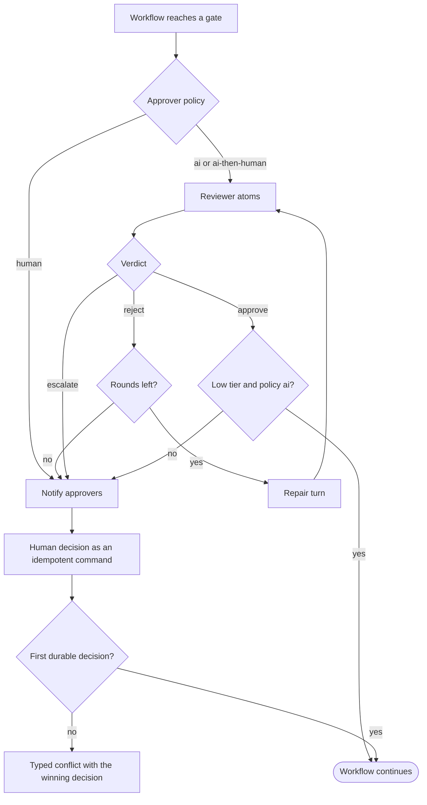

# People in the loop

atomic is designed so that a person can follow any agent, redirect it, halt it
and approve its work, and so that the decisions that count are still there after
a restart. This page shows how the terminal, the control plane and the approval
channels fit together. For the user's guide, see
[Watch, steer and approve agents](../guides/controlling-agents.md).

## The CLI and app-server

From v0.5, atomic hosts Codex's app-server inside its own process, and each
Codex atom is an ordinary app-server thread. v0.1 is leaner: it drives atoms
through Codex's thread manager directly and offers recovery through
`atomic runs resume` and a local `atomic serve`, with no interactive stack at
all.

Hosting the app-server gives atomic what Codex's terminal client already relies
on:

- **The client talks to the server, not to the agent core.** It can use an
  embedded server, a local daemon reached over a Unix socket, or a remote
  endpoint, and it is published as a library that atomic can embed.
- **One server serves many clients.** atomic's own terminal client, a stock
  Codex client attached with `--remote`, and Codex's desktop and mobile clients,
  through remote control, all see the same threads.
- **Human-in-the-loop is already in the protocol:** approvals for commands, file
  changes and permissions, requests for user input, and MCP elicitation. A
  client that reconnects is shown any prompts still pending.
- **Threads can already be controlled:** they can be listed and read, a turn can
  be started with an output schema, and input can be steered, interrupted or
  queued.

Every atom thread is named for its step and work item, for example
`implement · item-42`. atomic records which workflow, step and item each thread
belongs to in its own store. Correctness never depends on app-server
notifications, because those can be dropped when the server is busy.

The first CLI release (M9) does not fork the terminal client. The stock client,
atomic's MCP tools and a statusline provider showing something like "3 running ·
1 waiting for you" are enough. The extended TUI (M10) will add atomic's own
panes (`/workflows`, `/graph`, `/gates`, `/atom`) as a small patch set that
lives in separate modules and touches the client at two hook points only, so it
can be carried onto a new Codex revision with little conflict. A client that
atomic redistributes keeps Codex's licence notices and ships under atomic's
name.

## Model-safe and human-only tools

atomic adds its controls as MCP tools, not as new protocol methods, so stock
Codex clients can call them with no protocol change. Two MCP servers run in the
process:

| Server | Holds | Who calls it |
| --- | --- | --- |
| `atomic` | Graph reads and proposals, messages, workflow status, `workflow_start` | Models and people |
| `atomic-admin` | Gate decisions (approve, reject), run control (cancel, retry, fork, pause), taking an atom over, and settling an `outcome_unknown` effect | People only, through a direct tool call from a client |

What protects the admin tools is not that models cannot see them. Each admin
call has to present a human credential that the sandbox has no way to read. On
a laptop that is a per-user token in the OS keyring, used over an admin socket
placed outside anything a runner can read; on a server it is the person's OIDC
token (M27). With Postgres, the two servers also connect as different database
roles, and the role used for model-driven work cannot decide a gate, change
policy, or promote stored text to a higher trust level. Both roles
live in one process, so this is an extra layer rather than the only one.

Changes such as a workflow moving on, a gate starting to wait or an atom
parking are pushed on the MCP event stream. Scripts and CI get the same
operations without a client, as `atomic workflows|graph|gates|atom … --json`.

## Running atomic

From v0.5, running `atomic` with no subcommand is the all-in-one mode. If a
control plane is already running and answers, it attaches to it; if not, it
starts a control plane and a local runner in its own process and opens the
terminal client.

| Command | Control plane | Runner | Terminal client |
| --- | --- | --- | --- |
| `atomic` · v0.5 | Attaches, or starts one in-process | Local | Yes |
| `atomic --remote <url>` · v0.5 | Remote | Wherever the remote places it | Yes |
| `atomic run` / `atomic runs resume` · v0.1 | In the foreground; a new run, or the same unfinished one | Local | No |
| `atomic serve` · v0.1 local, v0.5 team | In the foreground; an outside supervisor keeps it running in the background | Local, later the configured backends | No |
| `atomic runner` | No | The runner for one backend | No |
| `atomic workflows`, `atomic graph`, `atomic check` | Attaches, or starts one briefly | Only when atoms run | No |

- **Attach first.** atomic looks for a local `atomic serve` on its Unix socket,
  then for a `--remote` URL or a configured remote. An exclusive lock on the
  project's state directory guarantees that two processes never run workflows
  against the same database.
- **Closing a client.** Closing a client that is attached to a service running
  on its own leaves the service up. In all-in-one mode, closing the client stops
  the runtime inside it, and nothing hands the work to a background process.
  Unfinished runs are picked up again with `atomic runs resume <run-id>` or by a
  supervised `atomic serve`, keeping their original gate deadlines and budgets.

See [Run locally or with a team](../operations/running-atomic.md) and the
[CLI reference](../reference/cli.md).

## Human-in-the-loop scenarios

| Scenario | Mechanism | Survives a restart? |
| --- | --- | --- |
| Approve a command, file change or permission during a turn | An app-server approval request that any attached client can answer. Each atom declares `attended`, which forwards the request to people, or `unattended`, which declines it or parks the step | No: the turn ends with the process, and the step's retry asks again |
| An atom asks a person something during a turn | A user-input request that the client renders | No, for the same reason |
| Ask a person a question between atoms | A [question gate](#question-gates) | Yes |
| Approve the work between atoms | An entry in the gate store plus a durable receive; from v0.5 it is also mirrored as a `gate` item in the graph | Yes |
| Settle an effect whose outcome is unknown | The step parks as `outcome_unknown`; someone checks with the provider, then records what happened or allows a single resend through `atomic-admin` | Yes, the parked state does |
| Redirect a running atom | `turn/steer`; the input states a disposition (`queue`, `steer` or `replace`), and atomic records `human_steered` together with the text | The record does |
| Halt an atom | `turn/interrupt`; the step is parked, not retried | Yes, the parked state does |
| Take an atom over | `atomic-admin` pauses the workflow at that atom; the person works in its thread, then hands back a typed result or asks for a re-run | Yes, the pause does |
| Add work or reply | Graph tools from the client or the CLI; a workflow driven by the graph picks it up | Yes |
| Start a workflow from a conversation | The model calls `workflow_start` on the `atomic` server | Yes, once it has started |

Two rules keep this safe. First, gate decisions and the other admin actions can
only come from an authenticated call made by a person's client; a model's tool
call or an atom's shell can never make one. Second, every redirect, halt and
takeover is written to a journal before it is delivered or acknowledged, with
the person's identity, a command ID, the target and the disposition. Delivery
reuses that command ID. If the action cannot be deduplicated or checked against
the thread afterwards, recovery says its outcome is unknown rather than sending
it a second time. The evidence a gate shows is stored by content hash and kept
for as long as a decision or a recovery might need it; if the candidate or the
evidence changes, its digest changes and a new gate is required.

## Question gates

A gate can put a question instead of asking for approval. A question gate has an
`ask` and a typed `answer`, which is either a list of allowed choices or a
free-text schema. It is stored in the same gate store, reaches people through
the same channels, and gets the same reminders and escalation as an approval.

- The answer is the decision. It is passed to the next step as typed input, and
  an answer that is not one of the allowed choices is rejected.
- With `remember: true`, the answer is also saved as a dated entry in the
  goal's feedback log (see [planning](planning.md#goals)) or as a project
  memory.
- When the deadline passes, `on_timeout` decides: the step resumes with a stated
  default answer, or it parks.

Question gates come with the local gate store in M45.

## AI-reviewed gates

Reviewers are atoms too. A verdict therefore gets the same treatment as any
step's result: a checkpoint, a budget and an audit record. Review can be
attached in two places. Inline on an atom, it runs after the atom's own checks
and before later steps see the output. As gate policy in a workflow, it makes
the approver `human`, `ai` or `ai-then-human`.

```yaml
review:
  reviewers:
    - { atom: adversarial-reviewer, model: frontier }
    - { atom: security-reviewer, model: advanced }
  require: all      # or majority
  rounds: 2         # repair turns before escalating
  on_fail: human    # escalate; never pass silently
```

- **Sibling steps.** The author's candidate is checkpointed first. Every
  reviewer and every repair round then runs as a step of its own, so a crash in
  the middle of review never repeats an author turn that was already saved. The
  candidate and the graph changes it proposes stay private until they are
  published (see [durability](durability.md)).
- **Independent.** Each reviewer starts in a new thread, by default on a model
  from a different family than the author's. It is given the specification,
  the output or diff and the test results, and never the author's reasoning.
- **Adversarial and evidence-backed.** Reviewers are asked to find what is
  wrong. Their verdict is typed (`approve`; `request_changes` for a repair
  turn; `reject` or `escalate` for a person; with findings and their
  severity), every finding has to point at a file and line or a test,
  and their tools are read-only, though they can run tests in a copy of the
  worktree.
- **Repair loop.** A request for changes hands its findings to the author,
  who gets a repair turn to address them. After `rounds` attempts the gate
  escalates to a person. Each round is charged to the step's budget.
- **Calibrated decision atoms.** An atom of `kind: decision` puts typed
  questions to a small decision model and gets calibrated answers back: a
  probability for a yes-or-no question, or a distribution across options. The
  thresholds belong to the gate policy (approve above one value, escalate inside
  a band, reject below it), which turns an AI verdict into a number that can be
  audited and adjusted.

A model still never approves its own gate. A person writes the review policy;
the atom under review cannot pick, call or sway its reviewers; and its output is
handed to them marked untrusted, so a diff that instructs its reviewer to
approve it is just data. Pairing a strong reviewer at the gates with a small
local model as the author is an intended way to use this.



The v0.1 gate store (M45) includes a single reviewer that escalates to a person;
panels, reviewers on other providers, decision atoms and risk tiers come in
M46.

## Risk tiers

Each gate has a tier. On a low tier an AI verdict may approve. On a high tier,
such as production deploys, authentication and permission code, or large
refactors, an AI may only reject or escalate, and approving always takes a human
credential. A tier can also demand that the person has authenticated again
recently: in server mode a decision whose token shows no fresh step-up is
refused, and the strength of the authentication is stored with the decision. The
audit log keeps every verdict together with the findings, the model that
reviewed and the hash of its prompt. A later direction lets tiers follow an
atom's track record; see [directions](directions.md).

## Approvals outside the terminal

Most people who approve things will never open a terminal. When a gate opens,
atomic tells its approvers in the tools they already use and lets them decide
from there.

- **Channels.** Slack comes first (M33a); Microsoft Teams, email with signed
  one-time links, and generic webhooks follow (M33b). Each project configures
  its channels, and a gate can say which ones to use. See
  [Slack](../guides/slack.md).
- **Identity on every decision.** A chat user has to be mapped to the same SSO
  identity atomic uses everywhere else before their click counts. Clicks from
  unmapped users, and requests whose platform signature does not verify, are
  refused. An email link works once, expires quickly and belongs to a single
  approver. Every decision is audited.
- **Escalation.** Reminders go out before the deadline; after it, a backup group
  is asked; after that, `on_timeout` applies.
- **Comments flow back.** A rejection or a comment becomes input to the next
  atom and can be turned into an eval case (see
  [developer experience](developer-experience.md#learning-from-human-decisions)).

`atomic serve` will also serve a small web view of open gates and workflow
status (M33b), showing for each gate what it displays, who may approve it and
when it expires. It uses the same admin operations as the terminal.

## Web console

Managers and auditors want a browser rather than a terminal. From v1.0 (M49),
`atomic serve` will serve a mostly read-only web console built on atomic's own
API, offering:

- runs with their steps, reviewer verdicts and audit history;
- open gates, which can be approved after an SSO login, with the decision
  logged in the audit trail under that person's identity;
- the work graph and workflow diagrams, drawn with a Mermaid library shipped
  inside atomic and run at its strict security level, so no outside host is
  contacted and a title containing markup is displayed as plain text;
- a **fleet view** of every loaded project and atom with its owner,
  environment, cost for the period, eval pass rate, most recent run and open
  gates, so a platform team can see what is running and knows whom to ask about
  a sudden cost increase;
- an **annotate** action on each run's page: a label (wrong, right, negative)
  plus a note, which turns the run into an eval case recorded under the user's
  identity, just as `atomic runs show` allows.

For traces the console links to the trace backend instead of building its own
viewer. Every prompt and title it displays is treated as untrusted text.
