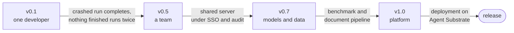

# Milestones and acceptance tests

atomic's work is cut into milestones, and a milestone is finished only when its
acceptance test runs green in CI. The numbers name milestones; they do not rank
them. The [phases](#phases) set the order.

A milestone that straddles two phases is split. Its "a" part is the smallest
slice the earlier phase depends on and carries its own test. Its "b" part
finishes the work later, and the full test for the milestone applies then.

Everything here is design. For what exists today, read
[Availability and delivery stages](../reference/availability.md).

## Phases

There are four phases, each closed by a gate that a real user has to get
through. A phase does not depend on a later one except where this page says
so. When a piece of the design is needed early but finished late, the early
phase gets a standalone version of it: v0.1 keeps gate decisions in a store of
their own, for instance, because the work graph only arrives with v0.5. Two
features do lean ahead: M42b's migration skill needs the M41 importer, and the
`--org` flag of M39b's `atomic render` needs M36b's organization overlays. Each
of those features waits until the milestone it needs has landed.

| Phase | Milestones | What has to pass before the next phase |
| --- | --- | --- |
| v0.1 · one developer | M0 to M4; M11a; M12; M23; M31a; M35a; M36a; M38a; M39a; M42a; M45 | Three file-defined atoms with a terminal gate between them run as one workflow. The process is killed once mid-run and once while the gate waits. `atomic runs resume <run-id>` brings the run back under its original ID, it completes, no finished step executes again, the budgets and the gate deadline are the ones it started with, and the evals pass |
| v0.5 · a team | M5 to M7; M9; M11b; M13; M14; M15; M16; M18; M27a; M28; M29a; M33a; M34a; M38b; M39b; M44; M46 | Several people use a single `atomic serve` backed by Postgres. They take work from the graph and answer gates in Slack after signing in through SSO, and the audit log holds every decision. Some of atomic's own work is done by its atoms, counted against the work done by hand |
| v0.7 · models and data | M17a; M34b; M40; M42b; M43a; M47; M48; M51; M52; M53; M54; M55; M56 | A single server running a local model of about 30B parameters, with the benchmark harness published, reports what the work graph changes. A document pipeline reads a folder of spreadsheets into typed records, and questions over a knowledge base are answered with retrieval filtered by the asker's permissions |
| v1.0 · platform | M8; M10; M17b; M19; M20; M21; M22; M24; M25; M26; M27b; M29b; M30; M31b; M32; M33b; M35b; M36b; M37; M41; M43b; M49; M50 | A deployment on Agent Substrate runs with encryption on, carries out deletion requests, ships signed releases and sends nothing to hosts outside its allowlist |

The v0.1 scope is settled. Inside each later phase, the order is worked out
when that phase is planned, following these dependencies:

- M23 ships together with M4.
- M27a and M28 ship together with M9.
- M29a ships together with M18.
- M14 precedes M15 and M16: tools and triggers are the doors untrusted input
  comes through.
- M12 depends only on M3, not on the graph or the CLI.
- The effect ledger arrives in M15; ownership epochs arrive in M19.
- M17a builds on M11 and on the managed Deno of M52, and M17b comes after M17a.

From M5 on, atomic tracks its own milestones in its own work graph.

## Gaps before production use

Declarative atoms, budgets, evals and tracing belong to v0.1. What still keeps
a team from relying on atomic is closed in v0.5:

| Gap | Effect today | What closes it | Milestone |
| --- | --- | --- | --- |
| Parallel work has no integration step | Commits from separate worktrees accumulate, and the main branch can break | A merge queue that rebases, tests and lands one change at a time, an atom that resolves conflicts, and a graph item for every merge it parks | M13 |
| Untrusted text has no boundary | Text from issues, web pages and review comments flows into other atoms, and atoms can run commands | Origin and trust labels on stored content, taint carried per field through outputs, tainted atoms denied network, gate creation, workflow changes and admin tools, and declassification only by a person at a gate | M14 |
| Work only starts by hand | CI failures, new issues, comments and schedules go unanswered | Webhooks, cron and file watchers that start workflows or file items, deduplicated by key, with everything that arrives tagged external | M16 |

M14 lands before M16, since triggers are the main route by which outside text
enters.

## M0: durare fork

**Delivers:** durare ported to sqlx 0.9, defaulting to SQLite with Postgres
behind a feature flag. `sqlx-postgres` comes from the transact-rs/sqlx fork
that Codex already patches in for `sqlx-core` and `sqlx-sqlite`, at the same
revision. Query data is committed for offline builds. The milestone also adds
the adapter that checkpoints a candidate and publishes it in a short
transaction, and a spike that drives durare the way atomic will: recovery,
`recv`, queues, cron, transaction steps, concurrent step positions, refusal of
nested steps, and an extra condition evaluated inside the checkpoint
transaction so ownership epochs can fence writes.

**Acceptance:**

- The fork's own tests are green against both SQLite and Postgres.
- Generating a new lockfile keeps the `libsqlite3-sys` that Codex pins.
- After 100 kills at random moments the spike finishes and no step that had
  completed ever runs again.
- Opening a step from inside a running step is an error.
- When the extra checkpoint condition is false, nothing commits.
- If the process dies between saving a candidate and publishing it, recovery
  publishes the saved candidate instead of producing a new one.
- Publishing is all or nothing: the accepted result and the whole graph batch
  appear together, or neither does.

## M1: Binary builds

**Delivers:** a single Cargo workspace pinned to one Codex revision. Codex comes
from atomic's fork, atomic-agentic/codex, which is the upstream release tag plus
two `utils/pty` commits that relax the parent-death signal where `prctl` is
refused; Codex core is untouched. The workspace carries Codex's
`[patch.crates-io]` block unchanged, plus one atomic line for `sqlx-postgres`,
and Codex's toolchain, and its `main` starts
from Codex's thread-manager sample with durare linked in.

**Acceptance:**

- `atomic` compiles.
- A single prompt goes through a Codex thread and an answer comes back.

## M2: Typed atoms

**Delivers:** the `Atom` trait and its Codex runtime with a repair turn, one
Codex atom, one lite atom, and a scripted fake model that tests can drive.

**Acceptance:**

- With the fake model and no provider configured, the golden test gets back an
  output that matches the atom's schema.
- When the fake model is scripted to answer badly, the atom asks for one repair
  and, if that also fails, returns a schema error.

## M3: Durable workflow

**Delivers:** the `atomic-durable` adapter, a `run_atom` step, and a workflow of
two atoms in which each invocation saves a candidate, reviews it in a sibling
step and publishes it in a transaction.

**Acceptance:**

- Kill the process once the first atom has checkpointed and restart it: the
  fake model has still been called only once for that atom.
- An atom that panics marks its own step failed; the process keeps running.
- Recovering a saved candidate costs no further call to the authoring model.
- A downstream step never sees a result that review did not accept.

## M4: Idempotent changes

**Delivers:** one git worktree for each step that edits code, reset to its base
commit before the atom runs; atomic itself commits the result, outside the
sandbox, and returns the commit; git runs in those worktrees with hardened
settings because the atom has written there.

**Acceptance:**

- If the process is killed while the atom works, the retry begins again from
  the base commit, and the step ends with exactly one accepted candidate commit.
- Under Codex's `workspace-write` sandbox at the pinned revision, the commit
  still succeeds.
- Hooks and git configuration that an atom plants in its worktree do not run
  when atomic makes the commit.

## M5: Local work graph

**Delivers:** `atomic-graph` on SQLite, with create, dependency, ready, claim,
close and remember operations. Items can carry `due_at`. A pinned `goal` kind
holds a measure history, a feedback log and an ignore list, managed by
`atomic goals add`, `list`, `show` and `feedback`. Beads JSONL can be imported
and exported, and atoms reach the graph through tools. A conformance suite
covers leases, imports and close policies. Claiming, heartbeats and releases
are orchestration operations, kept apart from the proposals a model buffers.

**Acceptance:**

- Run the same scenarios through beads on its SQLite backend and through
  atomic: the ready sets and the JSON fields agree.
- Of 50 simultaneous claims on a single item, one succeeds.
- Once a claim has been taken over, the previous holder can no longer write.
- A lease that ran out but that nobody else picked up keeps working for the
  agent that held it.
- A second import of one beads export is a no-op.
- When two workflows compete for an item, only one model turn starts.
- A crash at the moment a claim commits ends with the same acquisition reused,
  or with the takeover detected.
- An item whose `due_at` lies ahead stays out of `ready` until that time, even
  with every dependency closed, and shows up once the time passes; an item that
  is both due and blocked waits for both.
- A goal never shows up in `ready`; its child items do.
- Feedback added during one run is in the brief of the next run; an expired
  ignore entry is not.

## M6: Graph-driven workflow

**Delivers:** the loop that takes a ready item, claims it, runs an atom for it,
closes it with the resulting commit and files `discovered-from` follow-ups,
which may carry a `due_at` the agent suggests. Releasing an item leaves a
handoff record. Candidate batches publish only after review, and within one
attempt an atom can read its own unpublished proposals.

**Acceptance:**

- Kill the loop and restart it: no item is claimed or closed a second time, and
  the retried step keeps the claim it already had.
- The next agent to claim an item gets the earlier holder's handoff, with each
  file flagged as changed or untouched since.
- Proposals to close an item or file follow-ups that review rejects leave the
  committed graph as it was.
- A crash after the candidate is saved and before it is published reuses the
  model's output and never publishes part of a batch.
- A dated follow-up from a tainted atom arrives as a proposal for review to
  accept or reject; it is never written to the item directly.

## M7: Messages

**Delivers:** `message` items threaded with `replies-to` edges, and a cursor
over the local arrival sequence. A consumer picks its batch once and
checkpoints it as immutable versions with content hashes and an upper bound;
the cursor then moves by compare-and-set. Operation IDs make posts idempotent,
new messages raise wake-up events, and atoms get message tools. Every create,
edit and delete is its own immutable delivery event, cursors are tied to one
stream, and the bytes of a selected batch stay pinned.

**Acceptance:**

- Whether the crash comes after the batch is chosen, after it is summarized or
  after the cursor moves, each message is handled one time.
- Messages that arrive between selection and a crash go into the following
  batch; none is lost and none is merged into the summary already made.
- A step that retries does not post its reply twice.
- If a wake-up is missed, the next pull still finds the message.
- Edit and expire a message that a batch has selected, then crash: recovery
  summarizes the bytes that were selected, and the edit and the tombstone show
  up in a later batch.
- A cursor that belongs to a different stream is rejected.

## M8: Graph sync

**Delivers:** a log of graph operations stamped with a hybrid logical clock,
synchronised between machines through a dedicated git ref using `gix`, with a
merge that always gives the same answer.

**Acceptance:**

- Two replicas edit the same items while offline; after syncing, in either
  order, they hold identical state.
- A message from a machine whose clock runs five minutes slow still reaches a
  cursor that already exists.

## M9: First CLI release

**Delivers:** atoms running on Codex's in-process app-server, which also
listens on a Unix socket; two MCP servers, `atomic` and `atomic-admin`; a
statusline provider; headless `atomic` commands with `--json` output; and a
durable journal in which every human command is written before it is delivered.

**Acceptance:**

- An unmodified Codex TUI started with `--remote` shows the transcript of an
  atom that is running and can answer its command approval.
- Approving a gate through `atomic-admin` lets the workflow continue.
- Starting `atomic` a second time in the same project joins the running control
  plane rather than starting another.
- When a client attached to a supervised `atomic serve` exits, the workflow
  carries on.
- The model's tool list does not include the gate tool.
- An atom told to approve its own gate fails, whether it tries through its
  shell, the CLI or the admin socket.
- An admin command sent twice with one command ID acts once; reusing that ID
  for a different payload is an error.
- No admin call can add policy or loosen it.
- Input to an atom that is busy comes back labelled queued, steered or replaced.
- If the process dies after a steering command is accepted and before it is
  delivered, the command survives; when delivery is uncertain, atomic says so
  instead of sending it again blindly.

## M10: Extended TUI

**Delivers:** a small patch set on Codex's TUI, kept to two hook points, that
adds `/workflows`, `/graph`, `/gates` and `/atom`, refreshes them from the MCP
event stream, and journals steer, stop and take-over before delivering them,
with the result visible in step metadata.

**Acceptance:**

- Rebasing the patch set onto a newer Codex revision conflicts at the two hook
  points and nowhere else.
- Stopping an atom parks its step; resuming finishes it.

## M11: Declarative atoms

**Delivers:** `.atom.astro` atom files and `.workflow.yaml` workflow files, read
at startup and on reload, and the `run_pipeline` interpreter that executes any
workflow file. Workflow mappings are CEL. Atom files go through the bundled
Astro parser and a bounded TypeScript-shaped interpreter that never runs the
file as code; TypeScript helpers run in an isolate with no capabilities. The
milestone also covers typed collections and references, the schema registry,
lowering each output schema to the strict profile the provider accepts,
removing the nulls that lowering added, validating against the full contract
with one repair, load-time lint, and a macro for atoms written in Rust.

Several parts are already built: workspace member discovery with shared schema
and name resolution, local components with props and named slots, literal
`mermaid` fences in atom bodies, and generated editor types.

**Acceptance:**

- A workflow uses an atom that exists only as a file, and nothing is rebuilt.
- A schema that is malformed or cannot be lowered stops the load, naming the
  file and the JSON path.
- An answer that satisfies strict mode but violates a constraint of the full
  contract gets one repair turn and no more.
- A `null` the model returned for a field that lowering made nullable is
  dropped before validation; a `null` that the contract itself allows stays.
- `atomic check` reports a reference to an atom that does not exist, and an
  example whose output breaks the schema.
- Run from an unrelated directory, a workspace member resolves the shared
  schema IDs without the network, and two definitions with one name in one
  scope are an error.
- A schema written in YAML and the same schema in JSON load to the same
  contract; a repeated key, or a bare `yes` in an enum, is refused; one schema
  with sidecars in both formats fails `atomic check`.
- A value inserted into the prompt cannot close the element that wraps it, and
  an atom that writes a reserved `<data-…>` element itself is refused.
- Assignments, script statements, `<script>` and calls to anything other than
  helpers and intrinsics are rejected when the file loads and are never run as
  JavaScript.
- Mapping over a list in the body yields one block per item; mapping over a
  value that is not a list fails at load.
- Passing a prop a component does not declare fails `atomic check`; a named
  slot's fallback renders only if the caller supplies nothing for it.
- An unbalanced section tag fails the load.
- Every viewer shows markup inside a prompt as plain text.
- The compact schema form and its long form compile to identical JSON Schema; a
  field marked `?` can be left out but cannot be `null`; a compact field that
  would need a constraint is refused, with a hint to write full JSON Schema.

### M11a

**v0.1.** Atom and workflow files read at startup; `run_pipeline` running steps
in sequence with `with` mappings and gates; CEL; Astro bodies with typed
expressions and conditionals; the schema registry with lowering, null removal,
full validation with repair, and lint at load; exec atoms.

**Acceptance:**

- Three atoms defined only in files run as a workflow without a rebuild.
- A schema that cannot be lowered is refused at load, with its file and path.
- An answer that breaks the full contract but not strict mode is repaired once.
- The null added for an optional field by lowering is gone before validation.
- `atomic check` catches an atom reference with a typo.
- An exec atom runs a script that reads typed JSON and writes typed JSON, and
  no model is called.

### M11b

**v0.5.** Finishes M11 and must pass its full acceptance. New in this part: a
`wait` step (`for: 2d` or `until: <CEL timestamp>`) built on durare's durable
sleep, which outlives restarts and costs nothing while waiting; reloading
definitions; `foreach` with a concurrency limit; `extends` and base atoms; the
compact schema form; the package loader; editor schemas; and the macro for Rust
atoms. Workspace discovery, shared schemas, components with slots, `mermaid`
fences and editor types already exist and are covered by the same tests.

## M12: Cost, tracing and evals

**Delivers:** budgets for tokens, time and priced cost on atoms and workflows,
accumulated across retries and recovery, with each call reserved before it is
admitted. Eval cases are files with `input` and `expect`. Basic OpenTelemetry
spans arrive here (M44 completes them), with golden-set evals for each atom and
coding fixture tasks, each made of a seed repository, a prompt, a checker,
hidden tests and a reference solution. A replay mode serves model calls from
checkpoints, and a durable ledger records every request's reservation and
settlement apart from step output and telemetry.

**Acceptance:**

- Reaching a cap parks the workflow; it does not go on.
- Usage and open reservations survive retries and resumes; a parent cap and a
  child cap cannot both spend the same allowance; reusing a checkpoint charges
  nothing; configuring a dollar cap for a model without a price is an error.
- A recorded workflow replays with no model calls at all.
- When an atom's eval pass rate falls under its threshold, CI goes red.
- Each fixture's seed fails its checker and each reference solution passes it.
- Killing the process again and again after the provider has billed a call but
  before the ledger settles it eventually parks admission at the cap.
- Two parallel children cannot both win the last reservation.
- Attempts that failed or were rejected keep their spend, and the declared
  bound on how far a request can overshoot is enforced.
- CI fails when a scorer's mean drops below its declared floor, or falls
  further than its allowed tolerance relative to a baseline revision.
- Cases kept many to a JSONL file behave like cases kept one to a file.

## M13: Integration

**Delivers:** a merge queue, an atom for resolving conflicts, and a graph item
for each merge that has to be parked.

**Acceptance:**

- Three steps that ran in parallel and changed overlapping files reach the main
  branch one after another, with the tests passing after each.
- A conflict forced on purpose is either resolved by the atom or parked with a
  graph item that describes it.

## M14: Trust boundaries

**Delivers:** origin and trust on every item; a who-wrote-it level on stored
text (`human`, `approved`, `agent`, `external`); taint that follows content
through atom outputs; a tighter sandbox and a smaller tool set for tainted
atoms.

**Acceptance:**

- A corpus of injection attempts, such as an issue that tells every agent to
  approve its gates, leads to no admin action, opens no gate and reaches no
  network.
- Text that an agent wrote, or that was imported, is never placed into a prompt
  on its own, and nothing can lift it to a higher level by itself.

## M15: OpenAPI toolsets

**Delivers:** importing OpenAPI 3.0 and 3.1 specs; an HTTP executor inside
atomic with secrets scoped per atom and an allowlist of base URLs; the effect
ledger for mutating calls, with operation keys, provider idempotency keys,
reconciliation reads and `outcome_unknown`; gates per operation; tool search so
large specs stay out of context; durable operation slots that bind the first
request's hash, a namespace for provider keys and a retention policy for them;
mutations sent from deterministic steps; and effects that are declared, capped
and checked against content rules.

**Acceptance:**

- With a spec of 300 operations loaded, only the operations a search returned
  are in context.
- The process dies after a POST has been answered but before the step
  checkpoints, and the POST is not repeated: an idempotency key turns the
  resend into a duplicate the provider ignores; a reconciliation read finds the
  earlier effect; without either, the step parks as `outcome_unknown` and
  nothing is sent until a person decides.
- A DELETE behind a gate waits for approval, and once approved it is still sent
  only once if the same crash happens.
- Arguments that break the full schema are refused before a request is made.
- Two operation IDs with the same payload both run; retrying either runs
  nothing new; a different payload under an ID already used is refused; an
  expired provider key parks the step instead of producing a fresh key.
- Asking for an operation that was never declared, or exceeding the declared
  count, fails validation before any gate opens, and nothing is sent.
- Nothing is sent for an effect that violates its own content rules.

## M16: Triggers and HTTP API

**Delivers:** ingress from webhooks, cron and file watchers; a scheduler that
turns an item's `due_at` into an inbox event whose dedupe key is the item ID;
dedupe keys on every event; wake-ups registered from the `wake:` list in a goal
file, with the ignore list consulted before any run starts; external tagging of
everything that comes in; atomic's HTTP API, described by an OpenAPI document
with a schema fingerprint; and `atomic curl`.

**Acceptance:**

- One webhook delivered three times files a single graph item.
- After a restart, a cron schedule still starts its workflow at the right time.
- An item that fell due during two hours of downtime fires once when the
  service is back, not once for every poll it missed.
- Changing `due_at` before the item fires moves the event and leaves no stray
  copy behind.
- An event a goal chose to ignore yesterday starts nothing today, and starts a
  run again once that ignore entry has expired.
- Generated from atomic's OpenAPI document, a client starts a workflow and
  gets back what it returned.
- The API publishes its schema fingerprint; a client compiled against another
  fingerprint is warned and goes on working.
- `atomic curl` posts JSON to a served atom and prints the typed result, and
  running the plain `curl` command shown by `--print` gives the same result.

## M17: TypeScript atoms and workflows

**Delivers:** TypeScript for atoms and workflows, run by the managed Deno in a
process of its own: `.atom.ts` code atoms and `.workflow.ts` workflows, a
generated entry module and import map, a `config` export that atomic reads as a
literal without executing anything, permissions derived from what the atom
declares, the `atomic:std`, `atomic:schema` and `atomic:workflow` modules,
durable `sleep` and `waitUntil` on durare's durable sleep, generated types and
typed handles for atoms, replay that is deterministic, and code allowed only
from permitted origins.

**Acceptance:**

- What a code atom's `prepare` returns is available to its prompt.
- `prepare` can reach the host it declared through an npm package, and any
  other host is refused with an error that names it.
- An import missing from the lockfile stops the load.
- A `config` built from anything other than literals stops the load before the
  file is run.
- After a kill in the middle of a workflow, replay skips the finished steps and
  `prepare` calls, and a replayed `prepare` makes no request.
- `Date.now` and `Math.random` give the same values on replay.
- Workflow code can neither read files nor open sockets.
- No checkpoint, trace or model context ever contains a secret's value.
- A code atom that comes from a package outside the allowlist does not load.

### M17a

**v0.7, alongside M52.** Code atoms on the managed Deno, with `prepare` and
`validate`, `ctx.step` checkpoints inside them, `config` read as a literal,
generated types and the import map.

**Acceptance:**

- Values returned by `prepare` reach the atom's prompt.
- Through an npm package, `prepare` reaches its declared host and is turned
  away from any other.
- Replaying `prepare` runs none of its steps again and makes no request.
- A non-literal `config` fails the load without the file being executed.
- `atomic check` reports a type error when the prompt reads a prepared value
  that `prepare` does not return.
- Checking an atom that carries code makes no network request.
- An eval case that supplies `prepared` skips `prepare` entirely.
- `atomic runtimes lock` writes a lockfile identical, byte for byte, to the one
  committed.
- Code whose `prepare` declares a write fails the load, and `atomic eval` turns
  away an atom whose code writes, pointing to `atomic test`.
- A gate can display `steps.<id>.prepared`, and a workflow that reads a prepared
  path that does not exist fails `atomic check`.
- Under `atomic test`, only the local machine is reachable.

### M17b

**v1.0.** Finishes M17 and must pass its full acceptance: `.workflow.ts`
workflows that replay deterministically, typed handles for atoms, and durable
`sleep` and `waitUntil` that save a checkpoint before sleeping and wake on
schedule after a restart.

## M18: Postgres profile

**Delivers:** a storage trait per store, each implemented for SQLite and for
Postgres; durare, the graph and messages running on Postgres; wake-ups through
`LISTEN/NOTIFY`; and a single conformance suite run against both backends.

**Acceptance:**

- Both backends pass the conformance suite.
- On Postgres, 50 workers racing for one item produce one winner.
- The crash tests of M3 and M7 pass against Postgres.
- The database role that model-driven work connects as has no grant to decide
  gates or lift trust levels, so even a hand-written query under it fails.
- With Postgres unreachable the suite fails; it does not skip.

## M19: Remote workers

**Delivers:** several `atomic serve` processes drawing from shared durare
queues, each with a stable executor identity and its own recovery. A run's
ownership epoch guards every place a stale owner could do harm: checkpoints,
graph writes, runner results, merges and effect intents. An unkeyed effect is
resent only after proof that earlier dispatchers have been revoked and drained.

**Acceptance:**

- Kill one of three workers in the middle of a workflow: its runs continue,
  after a restart or on another worker, and no finished step runs twice.
- A worker cut off past its lease comes back after its replacement has taken
  over, and its checkpoint, its graph write, its runner result and its merge are
  all refused.
- Pause after the intent is committed and before the request goes out, move
  ownership, try a negative reconciliation, then let the old owner continue: the
  outcome is one accepted effect at most, or an operation parked unresolved.

## M20: Remote environments

**Delivers:** an `environment` field on atoms, resolved through Codex's
exec-server and its environment registry.

**Acceptance:**

- An atom declared with `environment: build-host` gets its shell and worktree
  on that host, while its thread and checkpoints remain on the local machine.

## M21: MCP publishing

**Delivers:** selected atoms and workflows offered as MCP tools, over stdio and
over streamable HTTP with OAuth, returning a run ID, progress, and the result as
a resource.

**Acceptance:**

- An ordinary MCP client starts the change-request workflow, follows its
  progress and gets back a result that passes the workflow's output schema.

## M22: A2A server and client

**Delivers:** an Agent Card, A2A tasks mapped onto workflow runs, `kind: a2a`
atoms, subscribing again after a crash, and external tagging of what remote
agents return.

**Acceptance:**

- The official A2A command-line client drives a published workflow from start
  to finish.
- A waiting gate appears to the caller as a task that needs input.
- Killing atomic while a remote A2A call is in flight ends with atomic
  subscribing to the existing task again; no second `SendMessage` goes out.

## M23: Execution seam

**Delivers:** the `ExecutionBackend` trait with only the local, in-process
backend behind it. On connecting, a backend states how durable its workspaces
are. Ships with M4.

**Acceptance:**

- Every test from M0 to M4 passes with all atom runs routed through the trait.
- The local backend states its durability, and a value atomic does not
  recognise is read as ephemeral.

## M24: Containers and Kubernetes

**Delivers:** the control plane (`atomic serve`) and the runner (`atomic
runner`) in their own processes; images for the control plane and for runners; a
Helm chart; health and readiness endpoints and a graceful shutdown; the runner's
exit codes as a contract; a `kubernetes` backend that gives each atom run a pod;
conformance transcripts recorded for `ExecutionBackend`; and a decision on how
Codex's state is kept.

**Acceptance:**

- The tests from M0 to M4 pass with the control plane and the runner in
  different processes.
- When a control-plane pod is deleted, another replica owns its runs within two
  minutes, and no finished step repeats.
- A runner pod killed in the middle of a step is replaced and the step starts
  again from its base commit.
- M19's partition test still holds when each replica is its own pod.
- Every runner exit class (clean exit, crash, usage error, configuration error,
  lease held by someone else) triggers the control-plane action documented for
  it, and an exit code atomic does not know counts as a crash.
- The `kubernetes` backend replays the transcripts recorded against the local
  backend and passes.
- A probe inside a runner can reach only what the atom declared as egress, and
  turning any single control off makes its test fail.

## M25: Substrate backend

**Delivers:** a client for the Agent Substrate API, an actor template for
runners, and an actor for each atom run. Actors are suspended at gates and when
idle, and a reaper at start-up suspends actors no live attempt owns. Placement
is retried and templates are checked for readiness. Attempts follow a
resumable contract. Egress policy is generated from what each atom declares,
every request from an actor has its token checked, and commits are pushed
before each checkpoint. A benchmark on Agent Substrate measures how many atom
runs a pool of workers can carry and confirms that runs stay isolated from each
other.

**Acceptance:**

- 100 atom runs at once on 10 workers all complete.
- An actor suspended at a gate wakes on a different worker after the gate is
  approved.
- No model or API credential is present in the actor.
- Losing an asynchronous snapshot costs one step's re-run and nothing more.

## M26: kagent bridge

**Delivers:** a bring-your-own kagent harness that connects kagent sessions to
atomic's A2A server, presents gates as kagent human-in-the-loop requests, and
forwards decisions with an actor token.

**Acceptance:**

- A conversation in kagent starts an atomic workflow, shows its gate as waiting
  for input, continues once approved in kagent, and the decision is recorded as
  made through kagent on behalf of its principal.

## M27: Identity and access

**Delivers:** OIDC on every endpoint, tested against Keycloak and open to any
other OIDC issuer. Users and groups are provisioned through the issuer's SCIM
API, which atomic reads and never serves. Authorization is relationship-based,
with project roles, approvers per gate, separation of duties, service accounts,
and model allowlists through managed requirements. Step-up for high-tier gates
— a tier that makes a decision need a fresh step-up login, such as a passkey —
is not part of M27: it arrives in M27a, which ships alongside M9.

**Acceptance:**

- Someone outside a gate's approver group is refused when approving it.
- The author of a change cannot approve it.
- Deprovisioning a user through SCIM removes their access at once.
- A model missing from the allowlist is refused.

### M27a

**v0.5, alongside M9.** OIDC sign-in everywhere, groups read from token claims,
approver groups per gate, no approving one's own change, model allowlists
through managed requirements, and step-up for high-tier gates: a gate tier may
set `requires_acr`, which makes a decision need a fresh step-up login such as a
passkey, with the ACR stored on the decision.

**Acceptance:**

- Every endpoint refuses a call without authentication.
- Someone outside a gate's approver group cannot approve it.
- The author of a change cannot approve it.
- A model missing from the allowlist is refused.
- On a server, a tier that requires step-up refuses a decision whose token
  has no fresh ACR and accepts one whose token has it; the audit entry records
  the ACR.

### M27b

**v1.0.** Finishes M27 and must pass its full acceptance: provisioning through
the issuer's SCIM API, relationship-based authorization, project roles, service
accounts registered as clients of the issuer with token-exchange delegation
when an agent acts for a person, and `atomic login` using the device
authorization grant.

## M28: Audit log

**Delivers:** an audit stream in which each record is chained to the one before
by hash, exported to a SIEM as OpenTelemetry logs, with retention, a mapping to
common controls and an evidence export. Ships with M9.

**Acceptance:**

- Each gate decision, tool call, egress request and admin action is recorded
  exactly once.
- Changing or deleting any record makes verification fail.
- Exporting the evidence for one workflow run yields all of it.

## M29: Encryption, secrets and tenancy

**Delivers:** encrypted transport everywhere, a secrets backend that can be
swapped, and the controls that keep tenants and their data apart: mutual TLS
between the control plane and runners, keys the operator owns, envelope
encryption of sensitive fields, workload identity in place of stored keys, and
per-tenant namespaces, keys and row security.

**Acceptance:**

- A raw dump of the database shows sensitive fields only as ciphertext.
- Keys rotate while the service keeps running.
- No credential with a long lifetime is stored on disk.
- A query made as one tenant returns none of another tenant's rows.

### M29a

**v0.5, with M18.** TLS on every listener and on the connection to Postgres,
plus the pluggable secrets backend. Secret values are kept out of database rows,
checkpoints, artifacts and traces.

**Acceptance:**

- In the team profile, a plaintext connection to any listener is refused.
- After a seeded run, searching every row, checkpoint, artifact and trace for a
  secret's value finds nothing.
- A secret changed in the backend takes effect without restarting atomic.

### M29b

**v1.0.** The rest of the milestone. Mutual TLS between roles, operator-held
keys, envelope encryption and workload identity arrive here, and tenants map
onto organizations in the identity provider (Keycloak is the reference; any
OIDC provider is accepted), each with its own login providers, domain routing
and invitations. Connected accounts also land: a person links an outside
account once through the issuer's brokering, and when a step needs it the
control plane turns that link into a named credential with a short life, handed
to the atom's own code and never to the model. atomic runs its own refresh for
those tokens. The full M29 acceptance applies.

## M30: Data lifecycle

**Delivers:** detectors for sensitive data with a hook on every egress path,
built on the M56 labels; redaction of personal data in logs, transcripts and
captured telemetry; residency pinning; retention rules; deletion that reaches
every store; and legal holds.

**Acceptance:**

- After a deletion request, the subject's data is gone or crypto-shredded in
  checkpoints, transcripts, graph items, messages, artifacts and snapshots.
- While a legal hold is in place, the same request deletes nothing.
- A field labelled confidential cannot leave by any egress path that is not
  approved for it.

## M31: Supply chain

**Delivers:** a CycloneDX bill of materials, Sigstore signatures, SLSA
provenance, a `cargo-deny` policy on licences and advisories, and a record of
every fork the build depends on.

**Acceptance:**

- `cosign` verifies each published release artifact.
- The SBOM names each fork in `deps/forks.toml` at its pinned revision: the
  Codex fork (`atomic-agentic/codex`), the durare fork and the
  `transact-rs/sqlx` fork.
- CI fails when a dependency carries a licence the policy does not allow.

### M31a

**v0.1.** The SBOM, signed release binaries, the `cargo-deny` policy and fork
tracking.

**Acceptance:**

- `cosign` verifies each release binary.
- The SBOM names every fork from `deps/forks.toml` with its revision.
- CI rejects a dependency whose licence is not allowed.

### M31b

**v1.0.** Adds SLSA provenance and signed container images. The full M31
acceptance applies.

## M32: Enterprise builds

**Delivers:** an install bundle that works offline, telemetry and update checks
and feedback switched off by default, support for corporate proxies and private
registries, and an investigation of a FIPS build.

**Acceptance:**

- On a machine with no internet access, the bundle installs and a workflow runs
  against a private model endpoint.
- A packet capture during that run shows traffic only to approved hosts.

## M33: Approvals outside the terminal

**Delivers:** gate decisions from Slack, Teams, email and webhooks, a web page
of open gates and runs, mapping of chat users to signed-in identities,
reminders, and escalation.

**Acceptance:**

- An approver whose Slack account maps to their identity approves from Slack,
  and the workflow continues.
- A click from a Slack user with no mapping changes nothing.
- An emailed decision link works one time only.
- When a deadline passes, the gate goes to the backup group.

### M33a

**v0.5.** Gates decided in Slack, each Slack user tied to an OIDC identity,
with reminders and the gate's `on_timeout`.

**Acceptance:**

- A mapped approver's Slack decision resumes the workflow.
- An unmapped user's click is refused.
- A request whose Slack signature does not verify is refused.
- A missed deadline applies the gate's `on_timeout`.

### M33b

**v1.0.** The remaining channels (Teams, email and webhooks), the web page of
gates, and escalating an overdue gate to its backup group. The full M33
acceptance applies.

## M34: Model layer

**Delivers:** local providers, a public benchmark harness, tier routing with
fallback, quotas shared by every worker, cost attribution, prompt-cache
ordering, and, for the gateway profiles, agentgateway configuration generated
from the same declarations the in-process path uses, and a cross-provider eval
report that runs the M12 evals on each provider. The harness runs a small local
model in two arms, graph and no graph, over fresh multi-session tasks that each
come with a decomposed plan; it records the arm, cost and hardware of every
attempt and reports pass rates with confidence intervals.

**Acceptance:**

- With the primary provider blocked, a workflow completes on its fallback, and
  the run records the switch.
- Ten workers drawing on one quota never go past it together.
- Cost reported per team agrees with the provider's invoices to within 2%.
- In the team profile atomic compiles those same fallback and quota declarations
  for agentgateway; with the gateway enforcing them and the runtime only
  watching, both tests above still pass, and changing a limit in the manifest
  changes the gateway's policy when `atomic serve` reloads.
- On the benchmark, the pass rates of a 30B-class local model with and without
  the graph are compared against a threshold fixed before the run. The harness
  is published so others can repeat it, and the result is reported whichever
  way it falls.

### M34a

**v0.5.** Ollama, vLLM and LM Studio as providers, each endpoint with its own
concurrency limit, and the public benchmark harness.

**Acceptance:**

- A workflow finishes on a local model through each of the three providers.
- Twelve atoms started together wait behind an endpoint's concurrency limit, and
  none fails because of it.
- One task set goes through both arms of the harness, graph and no graph,
  and the report gives completion rate, cost and hardware for each.

### M34b

**v0.7.** Everything else: routing by tier with fallback, quotas every worker
shares, cost per team, prompt prefixes ordered for caching, the gateway
configuration, the cross-provider eval report and the benchmark's published
result. The full M34 acceptance applies.

## M35: Artifact store

**Delivers:** a content-addressed blob store with a manifest per blob, backends
for a local directory and for S3, GCS and Azure, typed references in schemas,
and retention with garbage collection.

**Acceptance:**

- A 200 MB patch moves from one atom to the next as a reference, not as bytes in
  a checkpoint.
- Writing the same content twice stores it once.
- A blob nothing refers to is removed once its retention has passed.
- Each backend passes one shared conformance suite.

### M35a

**v0.1.** A local directory holds the blobs and their manifests; schemas can
reference artifacts by type.

**Acceptance:**

- A 200 MB patch reaches the next atom as a reference.
- Two writes of the same bytes leave one stored copy.
- Validation fails for a reference whose artifact does not exist.

### M35b

**v1.0.** The cloud backends, retention, garbage collection and the conformance
suite. The full M35 acceptance applies.

## M36: Format v1 and upgrades

**Delivers:** the `atomic: 1` format version, configuration in layers with
profiles and `ATOMIC_*` overrides, `atomic migrate`, versioned migrations for
every store, and recovery that knows which version wrote a run.

**Acceptance:**

- `atomic check` fails on a workflow or manifest file that does not state its
  format version; an Astro atom that omits it is read as `atomic: 1`.
- A workflow started on one binary completes after the binary is upgraded part
  way through.
- A binary refuses to start against a database written by a newer one.
- If an atom gains network access and `atomic.policy.lock` is left stale,
  `atomic check` fails; regenerating the lock produces a one-line diff.

### M36a

**v0.1.** The format version, layered configuration with profiles and
`ATOMIC_*` overrides, and versioned store migrations.

**Acceptance:**

- A workflow or manifest file with no format version fails `atomic check`; an
  Astro atom without one defaults to `atomic: 1`.
- Each configuration layer wins over the layers beneath it.
- A binary older than its database will not start.

### M36b

**v1.0.** `atomic migrate`, version-aware recovery, the committed policy lock,
and configuration overlays per organization. An overlay lives in
`organizations/<org>.yaml`, is chosen by the token's `org` claim and sits
between the profile and the environment. It is validated against the same
context schema, versioned, audited under the admin who saved it, and can never
grant a permission the layers below did not.

**Acceptance, beyond the full M36 test:**

- Saving an overlay with a value outside the context schema is refused, and the
  error names the key.
- From one profile, runs for two organizations see different `config` values.

## M37: Operations

**Delivers:** backups with point-in-time recovery, garbage collection, service
objectives with dashboards, alerts and runbooks, a Collector layout that tail
samples and routes, reference dashboards for Grafana and Datadog, and admin
endpoints that show resolved configuration, detected conditions, runs and
metrics.

**Acceptance:**

- A restore drill loses at most 5 minutes of data, finishes within an hour, and
  the workflows that were in flight carry on.
- Disk use stays level across a week of runs without pause.

## M38: Crash-test harness

**Delivers:** named failpoints throughout atomic, a crash suite that runs in CI,
property tests for graph merge, and load tests.

**Acceptance:**

- Firing each failpoint in turn ends in one of two ways: the workflow completes
  with no step's side effect repeated, or a step whose external outcome cannot
  be known is parked as `outcome_unknown`.
- Graph merge gives the same result for 10,000 random orderings of the same
  operations.

### M38a

**v0.1.** Failpoints before and after each checkpoint, inside an atom and inside
a commit, with the crash suite in CI.

**Acceptance:**

- For every v0.1 failpoint, the workflow finishes, no completed step runs again,
  and each code-changing step yields exactly one accepted candidate commit.

### M38b

**v0.5.** Adds failpoints in the work graph, message delivery, the merge queue
and the effect ledger, and load tests that stress scheduling and claiming.
Other failpoints follow the features they test: sync and the merge property
tests arrive in M8, a paused owner in M19, Substrate suspends in M25.

## M39: Developer tooling

**Delivers:** the commands a developer uses day to day (`init`, `dev`, `run`,
`runs resume`, a local `serve`, `runs show`, and `runs replay` that can step
through or fork), a language server, the docs site and example gallery, eval
cassettes, fixture repositories used through throwaway worktrees,
`eval --compare`, gates for dev mode, `--fail-at`, mock servers for OpenAPI and
stubs for MCP, a dev budget and local models, environment detection explained by
`config --explain`, errors that carry a fix in `--json`, and Mermaid exporters
with a stale-diagram check.

**Acceptance:**

- Someone new reaches a passing eval from `atomic init` in under 15 minutes.
- In dev mode, saving an atom re-runs its evals within 10 seconds.
- Replaying a recorded run calls no model.
- With cassettes, changing only a `validate` rule re-runs the evals without a
  model call.
- Running a Codex atom with `atomic run` leaves the developer's own checkout as
  it was.
- `eval --compare` shows pass rate, cost and output differences between two
  versions, and between two variants of one atom.
- A workflow stopped by `--fail-at` resumes and repeats nothing.
- An OpenAPI toolset works against the mock generated from its spec.
- A fresh laptop with nothing configured except an API key, or a running
  Ollama, can `init` and `run`; `config --explain` then traces every setting to
  its source.
- The Mermaid export of a workflow contains every step, gate and dependency in
  its file; an item title that contains Mermaid syntax appears as an escaped
  label.
- `atomic check` fails when a workflow changes but its committed diagram was not
  regenerated.
- `atomic render` prints the prompt a run would send and calls no model.
- `atomic check` fails when an atom's instructions change and its prompt
  snapshot was not updated.
- `--plan` prints the number of calls and a cost range, and calls no model.
- `--effects preview` takes a workflow to the end, recording each effect and
  applying none.
- The risk view of a workflow shows, per step, the resolved sandbox, network
  access, effect caps and gates, and reads correctly in monochrome.

### M39a

**v0.1.** `init`, `run`, `runs resume <run-id>`, a foreground local `serve`,
`check`, `runs show`, and `eval` backed by cassettes; coding fixtures checked
out into disposable worktrees; detection explained by `config --explain`; errors
that say what to do; explicit `--project`, and `--fixture` with `--fixture-rev`
as a pair; and a cassette key built from the complete effective request.

**Acceptance:**

- From `atomic init` to a passing eval takes a new user under 15 minutes.
- With only an API key or Ollama on a fresh machine, `init` and `run` need no
  configuration, and `config --explain` gives each setting's source.
- The developer's own checkout is left exactly as it was after `atomic run`
  executes a Codex atom.
- Changing a `validate` rule re-runs evals from cassettes with no model call.
- After kill and resume, the run keeps its ID, its completed results, its
  budget spent so far and its first gate deadline.
- While one resume is running, starting another is refused; an effect whose
  outcome is unknown remains parked.
- Run from directories outside the project, the coding example pins the same
  base commit and leaves the source repository unchanged.
- A bad path or a missing commit fails before any model call.
- `--project` accepts the manifest file or the directory that holds it, and an
  input read from a file, from standard input or from `--data` becomes the
  same run input.
- A change to validation alone reuses earlier results, labelled as historical,
  while a change to generation schema or model settings makes the recording
  unusable.
- `atomic run` returns the same result whether the target is named from inside
  the project or given as a path from elsewhere.

### M39b

**v0.5.** The rest of the developer loop: `dev`; `runs replay`, which can step
through a run or fork it; `eval --compare`; gates for dev mode and `--fail-at`;
mocks generated from OpenAPI specs and recorded MCP stubs; a spending limit per
dev session; the language server, the docs site and the gallery. It also brings
the Mermaid exporters (with the stale check, the risk view and the cost view),
prompt snapshots for `atomic render` along with `--as` and `--org` to render
for a given principal and organization, the `--plan` preview, the
`--effects preview` mode and variants. Workspace
member discovery and shared schema and name resolution are already built and
are not part of this work. The full M39 acceptance applies, with one clause
moved here from M39a: in v0.1 no tool definition and no prepared value reaches
a recorded request, so only M39b can show that editing them throws a recording
away.

**Acceptance:**

- A change to prepared context or to a tool fixture makes the recording
  unusable.

## M40: Learning loop

**Delivers:** one action that turns a rejected gate, the edits from a take-over,
or a steering message into an eval case; marking any run, from `runs show` or
the console, as a labelled case with a note (a finding someone dismissed
becomes a negative case); and a red-team generator that reads an atom's
`trust`, `tools` and `effects` declarations, derives prompt-injection and
over-reach cases from them, and runs those cases as evals on a schedule.

**Acceptance:**

- One action turns a rejected gate into a case holding the input, the rejected
  output and the reason, and the case keeps failing until the atom is fixed.
- A run that passed all its gates can be marked wrong and becomes a failing case
  in the same way.
- For an atom with `trust: external` and write effects, the generator produces
  a case whose external input asks for the write; it keeps failing until a
  validator rejects that write or the atom's trust is lowered.

## M41: Import

**Delivers:** an importer, `atomic import`, that reads agent definitions from
Codex (roles, skills), Claude Code (subagents, skills), `AGENTS.md` and kagent,
and that also moves typed prompt files in both directions.

**Acceptance:**

- Each supported source becomes `.atom.astro` files that pass `atomic check`,
  and any field with no equivalent is listed.
- Dotprompt, Prompty, Agent-Flavored Markdown and AgentMark prompt files arrive
  as lite atoms with their schemas.
- A lite atom exported to Dotprompt or Prompty imports again with schemas
  unchanged.

## M42: Authoring skills, first pack

**Delivers:** four skills, `atomic-create-atom`, `atomic-project-setup`,
`atomic-plan-migration` and `atomic-create-component`, with reference sections
generated from atomic's schemas, and `atomic setup` for Claude Code, Codex
and Cursor.

**Acceptance:**

- Given a one-sentence task in a new repository, Claude Code and Codex each
  write a working atom using the installed skills, and `atomic check` and
  `atomic eval` pass with no hand edits.
- Given two atoms that repeat the same guidance, `atomic-create-component`
  moves it into one shared component that both use, and `atomic render` output
  for each atom does not change.
- Each skill passes validation against the Agent Skills specification.
- `atomic setup` adds itself to an agent's existing configuration without losing
  or reordering the user's settings, and removing it leaves the earlier state.
- Pointed at two sample projects, one built on another agent framework and one
  on Claude Code, `atomic-plan-migration` writes a plan that covers each agent,
  prompt and tool, marks each one import, wrap or rewrite, and takes the first
  item through its gate with eval cases that pass against the original's
  recorded behaviour.

### M42a

**v0.1.** The first skill, `atomic-create-atom`, whose reference files are
generated, and `atomic setup` targets for Claude Code and Codex.

**Acceptance:**

- In a new repository, Claude Code and Codex each build a working atom from a
  one-sentence task, with `atomic check` and `atomic eval` passing and nothing
  edited by hand.
- The skill passes Agent Skills validation.

### M42b

**v0.7.** `atomic-project-setup`, `atomic-create-component`, Cursor support,
and `atomic-plan-migration`, which needs the M41 importer and the M5 graph. The
full M42 acceptance applies.

## M43: Packs and atomic new

**Delivers:** a package loader (`packages:`, namespaced names, `atomic.lock`,
trust rules); imports of pack components through `@packs/*` with editor path
mapping; a `pack:` block in the manifest that lists what the pack exports,
when it activates, what it needs, its configuration defaults and the schema of
its context; the commands `atomic add`, `remove`,
`packs list` and `packs show`, `update` (which shows prompt-snapshot and
policy-lock diffs), and `pack verify`, `pack publish` and `--vendor`; a
public registry with private indexes; six signed first-party packs; the rest of
the skills pack; the `skills:` field on atoms; `atomic new` with pack choice; a
warning for stale skills; and publishing skills to registries.

**Acceptance:**

- In a project whose remote is on GitHub, `atomic add github` writes the
  `packages:` entry and the lock, installs the pack's skills, and prints both
  the permissions its atoms declare and the secret it still needs; until that
  secret is set, `atomic check` fails with the same hint.
- A pack whose `requires` range leaves out the running binary is refused, with
  the change that would fix it.
- An `external` pack that ships an exec script does not load; the same pack
  pinned by hash at `team` does.
- When a pack's new version changes a prompt and adds a host, `atomic update`
  shows the prompt diff and the policy-lock diff before it writes the lock.
- The Astro editor extension resolves a component that a project atom imports
  from a pack through `@packs/`.
- The pack's `config.github.*` defaults are typed in a project atom's context,
  and a profile can override one of those keys.
- `atomic new` stops at an accept gate after producing an atom, a workflow and
  evals, all of which pass `check` and `eval`.
- Listing a skill under `skills:` makes it available in the atom's thread.
- A skill that carries scripts and comes from an origin not on the allowlist
  does not load.

### M43a

**v0.7.** The package loader: `packages:` entries with a git source, revision
and trust; namespaced names; `atomic.lock`; code is refused from `external`
packages and allowed only from `team` packages pinned by hash; `@packs/*`
imports with editor path mapping; and `atomic add <git-url>` with `remove`.

**Acceptance:**

- A project consumes a pinned git package, calling one of its atoms by
  namespaced name and importing one of its components through `@packs/`, and
  `atomic check` fails when the
  fetched content does not match the hash in the lock.
- An `external` package that carries an exec script fails to load, with a
  message that names the rule.

### M43b

**v1.0.** The `pack:` block, the registry and private indexes (an existing
open-source agent registry is evaluated first, before atomic builds its own; the
repository and the fleet view remain the record of what is installed), signed
first-party packs, `atomic update` with its diffs, `pack verify`, `--vendor`,
all six first-party packs, and pack choice in `atomic new`. The full M43
acceptance applies.

## M44: Observability core

**Delivers:** one pinned version of the GenAI conventions mapped in one place,
the `atomic.*` attribute namespace, a trace for each step attempt linked to its
workflow, trace context saved in checkpoints, propagation into Codex turns and
runners, the core metrics, content capture that is off unless enabled, and
`atomic dev --otel`.

**Acceptance:**

- A workflow killed and then resumed shows traces linked across the restart,
  and its cost is counted once.
- A gate that waits two days still yields traces that export the whole time.
- Atom and tool spans display correctly in each of Langfuse and Jaeger.
- Unless capture is turned on, no prompt text leaves the process.

## M45: Local gates

**Delivers:** a gate store in atomic's own database that needs no work graph;
gates as durable `recv` waits; proposal and evidence hashes that cannot change
and stay pinned while a decision or a recovery may still need them; a terminal
prompt inside `atomic run`; question gates (`ask` with a typed `answer`,
`remember`, and a default when time runs out), kept in that store and sent on
those channels; a single reviewer atom whose typed verdict escalates to the
terminal; and the commands `atomic gates enroll`, `list`, `approve` and
`reject`. An operator enrolls a credential once per project, held in the OS
keyring, and a decision counts only when it carries that credential (see the
[CLI reference](../reference/cli.md)).

**Acceptance:**

- In a build without the work graph, a gate outlives the process, comes back
  through `atomic runs resume <run-id>` or a local `atomic serve` with its first
  deadline, and is approved from another terminal.
- A gate whose time ran out while nothing was running is rejected when the run
  recovers.
- With approvers left out, only the local operator can decide; in server mode
  the load fails unless an allowed group is named.
- Sending the same decision again returns the first result; a different decision
  on a decided gate gets a typed conflict that carries the winner.
- Approval attempted by an atom, from its shell, of the gate in front of it is
  refused.
- A reviewer finds a seeded bug and escalates once its repair rounds are used
  up.
- An approval cannot carry over to a candidate or evidence whose content
  changed.
- A question gate answered in the terminal resumes its step with the typed
  answer, writes the feedback entry when asked, and resumes with the declared
  default if nobody answers in time. An answer that is not one of the enum's
  values is refused.

## M46: AI-reviewed gates

**Delivers:** reviewer panels, reviewers on providers other than the author's,
decision atoms that return calibrated probabilities against thresholds set in
policy, risk tiers, reviewer tools that can only read, reviewed output tagged as
untrusted, verdicts written to the audit log, and evals for the reviewers
themselves.

**Acceptance:**

- Every bug seeded into the eval set is caught by the panel.
- A diff that tells its reviewer to approve it is rejected or escalated.
- No AI verdict approves a high-tier gate.
- The audit log holds every verdict.

## M47: Planner and executable criteria

**Delivers:** a built-in `plan` step that files graph items with criteria,
dependencies and a size limit for each tier; goal records loaded from
`goals/*.goal.yaml` into pinned items, with the measure sampled on every wake
and the goal's brief (measure, feedback, ignores, closed children) given to
every plan step; a `consider` step on the cheapest tier whose `no_action`
outcome is recorded; a deterministic planner over atom types; focused, closed
and open modes with goal approval; detection of stuck runs; a gate on the plan;
planner evals that also score how new a plan is compared with the closed
children; and criteria written as test commands, CEL checks or HTTP probes,
which run before any reviewer.

**Acceptance:**

- A goal from the eval set turns into a reviewed plan, and each of its items
  passes its executable criteria.
- No reviewer is told a step passed when its test criterion failed.
- A heartbeat wake with nothing to do ends in `no_action`, with a reason, one
  unit of budget spent and the graph untouched.
- Once a goal's feedback rejects a topic, the planner does not propose it again,
  and the planner eval fails if it does.
- The goal's measure history has one sample for each wake.

## M48: Code context

**Delivers:** a repository map built with tree-sitter, tool unfolding,
selection of the files relevant to each item, and both attached when an item is
claimed.

**Acceptance:**

- The M34 benchmark is run in two arms, one with the repository map and one
  without, and the gap between them is published.
- A `file` tag naming a symbol puts that symbol's code, as of the pinned
  commit, into the prompt as labelled data; when the symbol no longer exists,
  the step fails and names the path and the symbol.

## M49: Web console

**Delivers:** a browser view, mostly read-only and served by `atomic serve`, of
runs, gates, the graph, reviewer verdicts and audit history; a fleet view that
puts every project and atom on one page beside the person who owns it, where it
runs, what it cost, how its evals pass, when it last ran and which gates wait; a
button on each run's page that files it as an eval case (M40); approving gates
after an SSO login; and workflow and graph diagrams drawn with a bundled copy of
mermaid.js.

**Acceptance:**

- An auditor holding a read-only role finds the whole approval history of a run
  in the browser.
- A gate approved in the console appears in the audit log under the person's
  SSO identity.
- Diagrams render without contacting any outside host, and markup in an item
  title is shown as text.
- Every loaded project appears in the fleet view with its owner and its spend
  over the past week; when one atom's cost jumps, the view says who owns it.

## M50: Java and Spring example

**Delivers:** a public example: a Spring Boot application whose springdoc spec
serves as an atomic OpenAPI toolset, whose `@Tool` beans are exposed through
Spring AI's MCP server, and whose `ChatClient` launches atomic workflows as MCP
tools, with trace context carried across.

**Acceptance:**

- A request to the Spring application starts an atomic workflow, an atom in it
  calls back into a Spring `@Tool`, and the whole path shows up as one trace.

## M51: Databases as data sources

**Delivers:** `datasources` configuration with grants per atom; schemas read
from the Postgres catalog into the registry and checked for drift; parameterized
named queries exposed as typed tools; ad-hoc read-only SQL with limits; change
sets proposed by an atom and applied after a gate; redaction of sensitive
columns; and a migration workflow that runs first on a throwaway copy.

**Acceptance:**

- Over a schema that already exists, an atom answers a question by calling a
  named query and receives typed rows.
- `atomic check` fails once a column the queries use has been renamed.
- The read-only role refuses an ad-hoc write.
- A proposed change set waits for its gate before it is applied; if the process
  dies after applying it but before checkpointing, recovery does not apply it
  again.
- No trace ever contains a sensitive column.

## M52: Files, scripts and runtimes

**Delivers:** the `atomic:file` type, with `/inputs` and `/outputs` backed by
the artifact store; scratch workspaces; toolchains from a pinned image or a
lockfile, prepared once by a setup step whose result is cached; a DuckDB tool
over files; handling for untrusted files; a heartbeat that keeps a long exec
step's lease alive (exec atoms as such arrive earlier, in M11a); and the
managed Deno that code atoms and scripts run on, which arrives in v0.7. Today,
separately, `deno_core` with V8 is already linked into the binary, for helper
isolates and for the Astro compiler every declarative atom passes through; the
managed Deno is a different runtime, for atom code.

**Acceptance, files and data:**

- A workflow turns a folder of spreadsheets into typed records, and the only
  model call is its judgment step.
- Replay runs none of that work again.
- A macro in an `.xlsm` file is never executed.
- A zip bomb is rejected.
- With the pinned image, an atom gives the same output on a laptop and on a
  server runner.

**Acceptance, scripts and their permissions:**

- A Deno script reaches the host its atom declares, and any other host is
  refused with an error that names it.
- An import missing from the lockfile fails the run.
- The script sees only the environment variables its atom declares; asking for
  any other returns nothing.
- No checkpoint, trace, artifact or log contains a secret's value.
- Repeating a create-only write returns the earlier result and overwrites
  nothing.
- Locking refuses any release younger than `minimum_dependency_age`.
- A package's install script runs only when the manifest names it.
- An import that `allow_packages` does not cover fails the load.
- With `audit_permissions` set, the step's trace lists each host and variable
  the code used.
- `--effects preview` skips any step whose code declares a write.

**Acceptance, the managed Deno:**

- A project with atom code downloads Deno on its first run and on no later run.
- An archive whose hash does not match the one built into atomic is refused, and
  nothing is installed.
- A project without atom code downloads nothing.
- When downloads are forbidden, the load fails and points to
  `atomic runtimes install --from`.
- `binary: system` pointing at a version atomic does not support is refused.
- A server in team mode never downloads while running.

**Acceptance, named credentials:**

- The keys handed to a step for its named credential expire, carry the run and
  step in their session name, and never show up in a checkpoint, a trace, a
  log or the model's context.
- An atom that names a credential the manifest does not define fails to load.

## M53: Retrieval (RAG)

**Delivers:** an `embed` capability in the model layer (hosted providers, local
servers and an in-process ONNX model) that knows each server's input limit and
shortens and retries; sqlite-vec and pgvector indexes with hybrid search; an
ingestion workflow that is safe to repeat; a `retrieve` step that hands out
short citation handles for the run (`S1`, `S2`) plus search tools; ACL
filtering inside the query; index versions swapped in atomically; citations
checked twice, by a validator against what was retrieved and by a built-in
verify step against the source, with the failing quote shown next to the cited
passage when a repair is needed; and retrieval evals that score recall at the
document level and keep deterministic metrics beside judged ones.

**Acceptance:**

- Ingestion of a corpus that is killed part way resumes, and finished documents
  are not embedded again.
- Ingesting documents that have not changed makes no embedding call.
- A user never receives a chunk that their identity is not allowed to read.
- An answer that cites a chunk which was not retrieved fails validation.
- An index rebuilt on a new embedding model is swapped in while running
  workflows carry on undisturbed.

## M54: Multimodal

**Delivers:** file types for images and audio, an image tag with a detail level,
flags for what each model can do and routing that respects them, screenshot
checks with visual evidence at gates, extraction of documents through vision,
removal of EXIF data, and media stored in cassettes by hash.

**Acceptance:**

- A gate on a UI atom rejects a seeded visual regression, with a screenshot as
  its evidence.
- A local vision model turns a scanned invoice into a typed record that
  validates.
- An atom that needs vision fails `atomic check` on a tier whose models have
  none.
- No trace holds image data.

## M55: Earned autonomy and outcome attribution

**Delivers:** reverts, bug reports, incidents and failed deploys linked back to
the run, atom version, model and prompt hash that produced the change, matched
by commit link, commit trailer and blob hash so the link holds through rebase
and squash; quality metrics per atom and per model; and a gate-tier policy that
raises or lowers an atom's tier from its track record, auditing every change.

**Acceptance:**

- Within an hour of a revert of a commit an atom produced, the revert is tied to
  its run.
- An atom that meets its promotion threshold, which the policy fixes in
  advance, moves to AI approval, and a single revert moves it back.
- The audit log records every tier change together with its evidence.
- `atomic stale --as-of` flags a decision whose eval evidence is older than its
  limit or came from a different model version, says why, and repeats that
  verdict exactly when run again for the same date on the same repository.

## M56: Sensitivity-based routing

**Delivers:**

- Labels that mark data as sensitive, attachable to a data-source column, a
  path, an artifact or a retrieved chunk.
- A `sensitivity.clearance` on each atom and a `clearance` on each tier entry
  of a profile; `atomic check` refuses an atom whose grants reach past its
  clearance.
- A classifier applied to every tool result before it joins a thread's context.
- A single policy check in front of every provider request, whatever made it:
  a turn's opening request or a follow-up after a tool result, a repair turn, a
  reviewer or decision call, a lite atom, an embedding, compaction, a sub-agent
  or a fallback.
- A step the check refuses starts again on a cleared model.
- Tighter sandbox and grants for atoms routed to external providers.
- Routing decisions written to the audit log.
- A spike on where the check sits in the local profile.

In the gateway profiles, agentgateway enforces the check from the sensitivity
claim on the per-run JWT, and the runtime restarts the step it refused.

**Acceptance:**

- When a step's input contains a sensitive column, it runs on a local model even
  if its tier lists a frontier model.
- An atom that begins with harmless input and then, during its turn, reads a
  labelled file or gets a sensitive tool result makes no more requests to an
  external provider, and its step runs again on a local model. Repair turns,
  reviewer calls and fallback behave the same way.
- With no cleared model available, the step parks.
- Behind a recording proxy in a seeded test, no request that carries labelled
  data reaches an external provider.
- Repeated in the team profile, that test passes too: agentgateway turns the
  request away and the runtime reruns the step on a model cleared for the label.
- The audit log holds every routing decision and why it was made.
