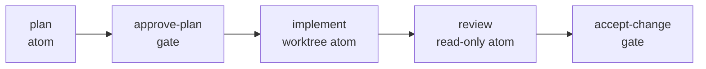

# Workflows

A workflow composes atoms, gates and other steps over typed inputs and outputs.
Composition is explicit and checked at load; it is never left to a model's
planning. The file format is specified in
[workflow files](../reference/workflow-files.md); this page describes how the
runtime treats a workflow.

Workflows are YAML first (v0.1). TypeScript workflows follow in v1.0 (M17b, see
[code, scripts and runtimes](runtimes.md#typescript-workflows)) and run on the
same engine; the two forms can call each other.

## The workflow interpreter

One durable Rust workflow, `run_pipeline`, executes every workflow file, so a
new or edited workflow runs with no rebuild. The interpreter maps each kind of
step onto a durable operation:

| Step | Durable form |
| --- | --- |
| Atom step | The atom's execution, review and publication as sibling durable steps (see [durability](durability.md#candidates-and-publication)) |
| Gate | A gate-store entry plus a durable `recv` that the decision completes |
| `worktree: true` step | A Codex atom in its own worktree at the step's immutable `base`; atomic commits afterwards and records the SHA in `steps.<id>.metadata.commit` |
| `foreach` (v0.5) | Items on a durable queue with the declared concurrency |
| `wait` (v0.5) | The engine's durable sleep, for a duration or until a CEL timestamp; it survives restarts and costs nothing while it waits |

A typical v0.1 coding workflow plans a change, waits for approval of the plan,
implements it in an isolated worktree, reviews the candidate commit in a
read-only workspace and asks the local operator to accept it. It returns a
reviewed result and does not integrate or push anything.



Runtime facts stay separate from model claims. A commit SHA comes from
`steps.<id>.metadata`, which atomic writes; a model's typed output cannot stand
in for it. Steps are ordered by `after`, never by YAML key order.

Expressions in `with`, `foreach`, gate fields, `returns` and validators are CEL.
CEL is typed, quick to evaluate and cannot cause side effects, which is why a
workflow file has no way to execute code.

## Runs are pinned

A run records the content hash of its workflow file and of every atom it uses,
and snapshots the compiled definitions into the artifact store when it starts.
Recovery continues against those versions. Editing a file changes new runs only,
and old versions stay available for replay and inspection.

Mutable inputs are resolved before admission: a branch name becomes a commit
SHA before the run starts, and a coding fixture is snapshotted (see
[below](#coding-fixture-binding)). Steps pass immutable commits and artifact
references, not whatever happens to be left in a workspace.

## Checked at load

Before a run starts, atomic checks that:

- every `atom` reference resolves to a registered atom;
- every `with` mapping fits the target atom's input schema, and `returns` fits
  the workflow's declared output, as far as the structural check can prove
  (anything it cannot prove is a warning, never a silent pass);
- every CEL expression compiles and type-checks against the schemas it reads;
- every gate's approvers resolve. Locally, a gate that names no approver goes to
  the signed-in operator. On a server there is no such default: project policy
  has to supply a permitted group, and if it does not, the workflow does not
  load.

Errors carry the file, the path and an action, in the style described under
[conventions and defaults](developer-experience.md#conventions-and-defaults).

## Review before integration

`after` orders steps by completion only; it says nothing about whether a review
approved. A reviewer's `request_changes` does not stop a dependent step on its
own; progress is authorized by a review policy or an explicit human gate.
Rejected, expired or unresolved gates stop every step that depends on them.

From v0.5 the parallel variant of the coding workflow reviews each candidate
before it enters the merge queue (M13). A rebase or a conflict resolution
yields a different commit, and that commit is what has to pass tests and review
before landing.
Approvals bind to the content that was reviewed; changed content needs a new
gate.

## Coding fixture binding

Code-backed development runs and evals bind their repository explicitly, so
atomic never falls back to the developer's own checkout (v0.1, M39a):

```sh
atomic --project <dir> run <workflow> --input <file> \
  --fixture <repo> --fixture-rev <rev>
atomic --project <dir> eval <atom> --fixture <repo> --fixture-rev <rev>
```

- `--project` accepts either the directory holding the manifest or the manifest
  itself. It can be left out whenever discovery already finds the project: when
  the command runs from inside it, or when the target given is the path of an
  atom or workflow file.
- `--fixture` and `--fixture-rev` are a pair. Lite and other non-coding tasks
  need neither; coding development runs require both.
- The operator points atomic at a repository already on disk and set up by hand.
  atomic resolves the revision to an immutable commit, snapshots the reachable
  objects it needs into the state directory, records the source, tree and commit
  hashes, and runs each attempt in a detached worktree of that snapshot. Later
  changes to the source cannot alter an admitted run.
- Every input field typed `format: git-commit` has to name a commit present in
  the snapshot, and any base field has to agree with the chosen base. A missing
  repository, revision or object, a placeholder SHA or an inconsistent base
  fails before any model call.
- Submodules, missing LFS objects and external alternates are not fetched
  implicitly; they need explicit materialization or the setup fails.
- Preparing a fixture is the operator's job, done with a script they run; no
  model writes or runs setup commands. The first version accepts neither a
  remote URL nor a script that clones on its own.

Workspace member discovery and shared-schema resolution across members are
already built (see [availability](../reference/availability.md)); sharing atoms
between members is still v0.5 (M11b, M39b). The command-line forms are in the
[CLI reference](../reference/cli.md#coding-fixture-selection), and the
[eval-case reference](../reference/eval-cases.md#coding-fixture-repositories)
covers fixtures for evals.
