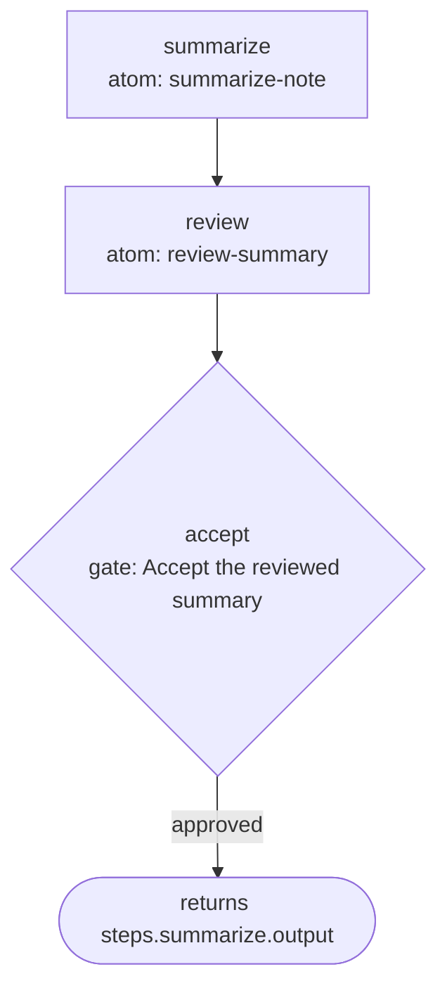
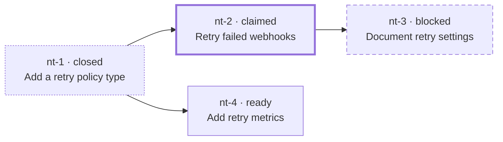
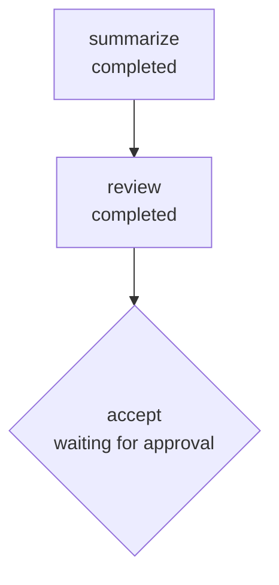
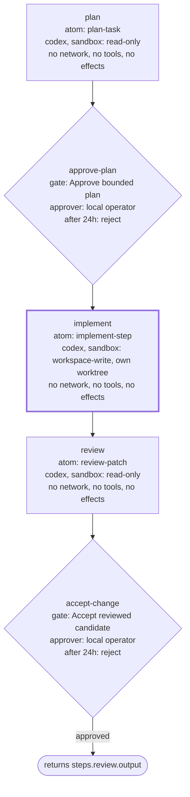
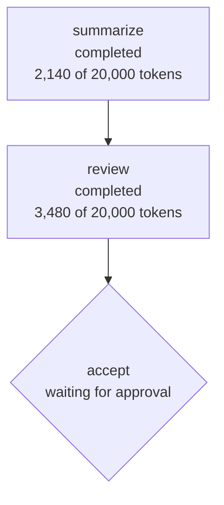
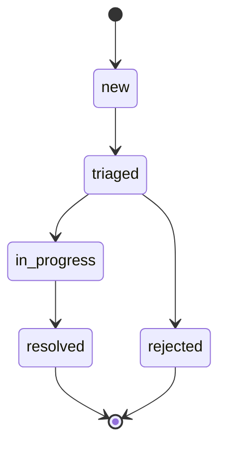

# Diagrams with Mermaid

Atomic uses [Mermaid](https://mermaid.js.org/) for diagrams: plain text in a
fenced block, which an agent can read as it stands and which GitHub and many
editors render as a picture. This guide covers the diagrams Atomic generates for
you, the views that show one source in different ways, how to keep a committed
diagram current, and when a diagram belongs in an atom's instructions.

The commands and markers below are proposed behavior, like the rest of the
[CLI reference](../reference/cli.md). The exporters are planned for v0.5; see
[availability](../reference/availability.md).

## Let Atomic draw what it already knows

A workflow file, the work graph and a run each hold a structure. Atomic derives
the diagram from that structure, so it cannot drift from the source the way a
hand-drawn picture does. Three commands take `--format mermaid` and print a
diagram to standard output.

### A workflow

For the workflow from [your first workflow](../getting-started/first-workflow.md):

```sh
atomic workflows show summarize-and-review --format mermaid
```

The output has one node per step, a diamond for each gate, and an edge for each
`after` dependency:



Use it to check a composition before you run it: a step with no incoming edge
starts immediately, and a step you expected to wait for a gate should sit below
that gate.

### The work graph

```sh
atomic graph --format mermaid
```

Each item is a node, and an edge runs from a blocker to the item it blocks.
The status is written in the label and repeated as a border style, so the diagram
still reads correctly as text or without color:



Here `nt-4` is ready because its only blocker is closed, and `nt-3` waits for
the claimed item above it.

### A run

```sh
atomic runs show <run-id> --format mermaid
```

A run diagram has the workflow's shape with each step's current state. This one
is waiting at its gate:



It is a snapshot. Run the command again, or use
[the supervision surfaces](controlling-agents.md), to see later progress.

## Choose a view

One source can answer more than one question. The workflow and run exporters
take `--view`, which changes what each node shows and never changes the source.
The work graph has one view.

| View | What each node shows |
| --- | --- |
| Default | Structure: steps, gates and dependencies |
| `--view risk` | What the step is allowed to do: sandbox, network access, tools and effect caps, and for a gate who approves it and what happens on timeout |
| `--view cost` | The step's budget and, for a run, the tokens and spend so far |

### The risk view

```sh
atomic workflows show change-request --format mermaid --view risk
```

For the workflow in
[the reviewed coding change example](../../examples/02-change-request/README.md):



Read it as a reviewer would. Only `implement` can change files, it works in its
own worktree, and it sits between two gates. No step has network access, tools
or external effects. The values are the resolved ones, after the atom's file,
project defaults and managed policy are combined, so you see what a step may
actually do without opening each atom file.

The risk view is the picture; the
[policy lock](security-and-permissions.md#review-permission-changes-as-a-diff)
is the reviewable text. Use the view to understand a workflow and the lock to
catch a change to it.

### The cost view

```sh
atomic runs show <run-id> --format mermaid --view cost
```

A run in the cost view shows what each step has used against its
[budget](../reference/budgets.md). The numbers here are illustrative:



For a workflow that has not run, the cost view shows each step's budget alone. A
dollar amount appears only where reliable pricing is available, as for a
`cost_usd` cap.

### Readable without color

A generated diagram never depends on color. Each kind of node has its own shape:
a box for an atom step, a diamond for a gate and a rounded box for the result.
Status and authority are written in the label and repeated as a border style,
such as the heavier border on `implement` above. Color, where a renderer adds
it, only reinforces what the shape and label already say. The diagram therefore
reads correctly as source text in a terminal, in a monochrome print and for a
color-blind reader.

## Keep a committed diagram current

A diagram in a README is useful only while it matches the workflow. Put a marker
comment above a generated block to name its source:

````astro
## How a note is reviewed

<!-- atomic:diagram workflow=summarize-and-review -->

````

`atomic check` regenerates every marked block and fails when the committed copy
differs, which catches a workflow edited without its diagram. Refresh the blocks
with:

```sh
atomic docs --write
```

A marker can name a view as well, for example
`<!-- atomic:diagram workflow=change-request view=risk -->`. Examples
[02](../../examples/02-change-request/README.md) and
[05](../../examples/05-support-draft/README.md) each commit a risk-view diagram
this way, and the catalog checker regenerates both.

Unmarked diagrams are yours. Atomic does not rewrite them, and it does not
check that they are still true.

## Put a diagram in an atom's instructions only when it earns its place

A `mermaid` fence can be written as literal text in an Astro atom body and reaches the
model as text. It suits structure that prose states badly, such as the allowed
transitions of a state machine:

````astro
---
import type { Props, Input, Output } from '../.atomic/types/example';
import type { AtomConfig } from '../.atomic/types/authoring';
const { input }: Props = Astro.props;
export const config: AtomConfig<Input, Output> = {
  "description": "Propose the next status for a support ticket.",
  "kind": "lite"
};
---
Choose the next status for the ticket. Only the transitions in this diagram are
allowed. Return the current status when none applies.



Ticket: {input.ticket}
````

Three things to know:

- **A `mermaid` fence is literal.** atomic reads everything between
  ```` ```mermaid ```` and the closing ```` ``` ```` as text, so `B{Urgent?}` and
  `C<page>` are diagram syntax, never expressions or tags, and nothing inside is
  interpolated. Only `mermaid` fences work this way; another fence is ordinary
  prompt text, where braces start expressions. A fence left open is an error
  at its opening line, since it would make the rest of the body literal. A
  stock Astro editor does not
  know the rule and may underline braces in a diagram; `atomic check` is
  authoritative.
- **The diagram costs tokens on every run.** It counts toward the atom's size
  estimate like any other instruction text.
- **Its value is unproven until you measure it.** A plain list may work as well,
  and small models may follow a list more reliably. Compare the two versions
  with `atomic eval <atom> --compare <revision>` before keeping the diagram; see
  [test and improve an atom](testing-and-evals.md).

## Have agents return data, and let Atomic draw it

Models make syntax mistakes when they write Mermaid by hand. When an agent's
result should become a diagram, have the atom return typed data, such as a list
of steps and their dependencies, and derive the picture from that. The data is
checked against the atom's output schema; a hand-written diagram is not.

Where an atom really must return a diagram, the proposed contract types it as a
stored artifact with the media type `text/vnd.mermaid`, so later steps receive a
reference to it and not free text.

## Labels are data

Item titles and step names can come from outside your team, for example an
imported issue. The exporters generate their own node IDs (`n1`, `n2`, …), quote
every label and escape characters that have meaning in Mermaid. They never emit
links or click handlers. A title cannot add a node, an edge or a script to a
generated diagram.

## Where diagrams render

| Surface | Behavior |
| --- | --- |
| GitHub, and editors with a Mermaid preview | Rendered from the fenced block |
| Terminal, the interactive CLI and chat approval messages | Shown as source text |
| Web console, planned for v1.0 | Rendered with a bundled copy of Mermaid, so it needs no outside network access |

## What is still open

- **Checking hand-written diagrams.** `atomic check` validates the diagrams it
  generates. Parsing a diagram you wrote yourself, in an atom or a doc, needs a
  Mermaid parser that has not been chosen, so a syntax error there is found
  when the diagram is rendered.
- **Command and marker spellings.** `--format mermaid`, `--view`,
  `atomic docs --write` and the `atomic:diagram` marker are proposals, not a
  tested contract.
- **What each view puts in a label.** The risk and cost examples above show the
  intended content. The exact wording and layout of the labels are not settled.
