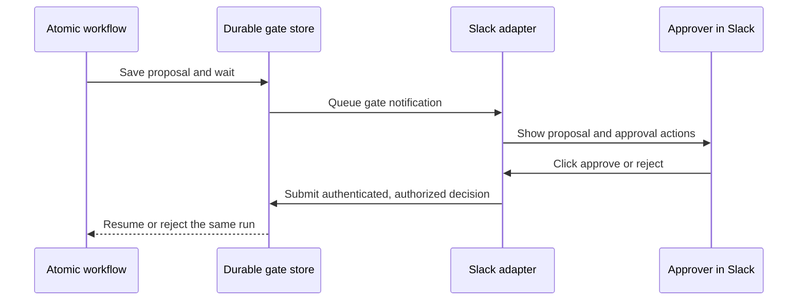

# Slack

Slack can give an agent context, start a workflow, or bring a decision to the
person who needs to make it. Those are three distinct integration roles; connect
only the roles your task needs.

| Role | Example | Atomic component |
| --- | --- | --- |
| Agent tool | Read a permitted thread or draft a response | Approved MCP server or typed API toolset |
| Workflow trigger | A message, mention or command requests work | Slack event/command adapter and durable ingress |
| Human control | Approve a proposed change and receive status | Notification adapter, gate store and authorized decision handler |

Atomic's Slack adapters are planned work. Initial Slack gate approvals are in
the v0.5 target; the exact connection commands and configuration schema are not
implemented yet. [Availability](../reference/availability.md) distinguishes those
adapters from capabilities already available in upstream services.

## Start with existing Slack tools

Slack provides an official MCP server at `https://mcp.slack.com/mcp`. It supports
searching Slack and reading/sending messages through approved access, using
Streamable HTTP. Slack requires a registered app and its supported OAuth setup;
a bare endpoint is not a complete connection. See the
[Slack MCP server overview](https://docs.slack.dev/ai/slack-mcp-server/).

Slack also publishes a [Codex connection guide](https://docs.slack.dev/ai/slack-mcp-server/connect-to-harnesses/#connect-to-codex).
It describes upstream client setup. Atomic's registration, credential storage
and tool selection remain planned; automatic import of an existing connection
is not specified.

A low-friction first use is read-only context and a draft:

> Summarize the decisions in this release-planning thread. Draft a status update
> with links to the messages you used. Let me review it before anything is sent.

The operator connects an approved app and selects the needed read tools. The atom
receives only those tools, and any service token stays outside the model's prompt
and runner workspace. A typed Slack Web API adapter is another option when a task
needs a narrower, deterministic operation than an agent-driven MCP call.

A Codex subscription authenticates model access. Slack authorization is a separate
connection; neither login substitutes for the other.

## Let Slack start work

The planned event adapter admits work quickly and runs it asynchronously:
Slack's [Events API](https://docs.slack.dev/apis/events-api/) retries delivery and
expects a prompt acknowledgement. HTTP events and Socket Mode are alternative
transports; Atomic's first transport choice is still open.

The proposed Atomic flow is:

1. Validate the transport and workspace/app identity. For HTTP requests, verify
   Slack's signature and timestamp against the raw body before parsing.
2. Deduplicate the event, then durably record the input and workflow-start intent.
   Events API deliveries have `event_id`; commands and interactions need their
   own replay-safe intake identity.
3. Acknowledge within Slack's deadline after durable admission, then run the
   workflow asynchronously. If admission fails, do not claim the work was accepted.
4. Bind the workspace/channel/user to a permitted project and named workflow.
   Message text supplies task data, not policy, credentials or arbitrary workflow code.
5. Reply with a run identity and update the originating thread as work progresses.

Slack documents [HTTP signature verification](https://docs.slack.dev/authentication/verifying-requests-from-slack/)
and [interaction acknowledgements](https://docs.slack.dev/interactivity/handling-user-interaction/).
The planned adapter filters its own bot output and irrelevant events so status
messages cannot recursively start new workflows.

## Approve a durable gate from Slack

The notification points to a durable proposal; it is not the proposal's only copy.
Bind the action to the run, gate and exact candidate/request. Map Slack workspace
and user IDs to the operator's Atomic identity and check the approver group when
the decision arrives. Slack authentication alone is not Atomic authorization.

A valid first decision wins. Replayed actions return the recorded outcome;
stale, conflicting or unauthorized actions cannot silently approve a changed gate.
Record the approver and decision, then update the Slack message from that record.
An agent-generated message saying “approved” is not a gate decision.

The CLI and Slack supervise the same durable run. A person can start it in the
terminal, approve its gate in Slack and inspect the result later with
`atomic runs show <run-id>`.

## Keep outbound effects recoverable

Reading a thread and posting a message have different effects. Route sends and
other mutations through Atomic's effect policy; do not assume the MCP transport
or a human gate makes them exactly once. Respect service rate limits and reconcile
uncertain outcomes before resending. Notifications need a durable outbox as well.

For example, a support workflow can read a permitted conversation, draft a reply,
wait for approval and send the exact accepted draft. The send has its own durable
operation identity. Uncertain delivery parks for reconciliation rather than
creating another reply blindly.

Treat Slack text as external data. Preserve its source identity and access scope,
and do not include private conversation content in public web-search queries.
See [web search](web-search.md) for that separate egress path.

Next: [control and approvals](controlling-agents.md) or
[the support-draft example](../../examples/05-support-draft/README.md).
