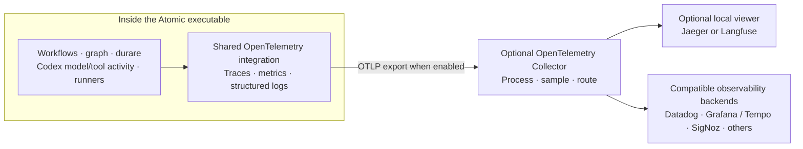

# Local observability and telemetry

Atomic is designed to explain its work locally before you configure an external
backend. Its binary includes run inspection and OpenTelemetry instrumentation
and exporters. Collectors, dashboards and services such as Datadog are optional
consumers of that telemetry.

These capabilities are planned; no Atomic runtime is implemented in this repository.
See [availability](../reference/availability.md) for the delivery stages.

## Start with built-in run inspection

Use the run identity reported by the CLI:

```sh
atomic runs show <run-id>
```

The planned local record shows: which steps completed, what they returned, where
work failed or waited, which attempts spent tokens, and where a person intervened.
Associated thread transcripts and artifact links provide the supporting detail.
The terminal can expose running state while the saved run remains inspectable
after a restart.

This is application-level inspection from durable records. It does not require
Docker, a Collector, a Datadog account or a trace viewer, and does not imply that
Atomic embeds a full APM database or dashboard product.

## Export basic spans (v0.1)

Set the standard OpenTelemetry exporter variables and atomic exports a span for
each workflow run, one for each step it executes and one for each model call,
over OTLP:

```sh
export OTEL_EXPORTER_OTLP_ENDPOINT=http://localhost:4318
export OTEL_EXPORTER_OTLP_PROTOCOL=http/protobuf   # or grpc, or http/json
atomic run triage --data '{"text": "..."}'
```

`OTEL_EXPORTER_OTLP_TRACES_ENDPOINT`, `OTEL_EXPORTER_OTLP_TRACES_PROTOCOL`,
`OTEL_EXPORTER_OTLP_HEADERS` and the exporter's other `OTEL_*` variables work as
the specification says, and `OTEL_SDK_DISABLED=true` or
`OTEL_TRACES_EXPORTER=none` turns export off. With no endpoint set, nothing is
exported. A protocol atomic does not export is reported in a warning, and the
command runs without spans. The `OTEL_*` variables are atomic's own: atoms'
commands, exec and Codex alike, never see them, so a collector credential in
`OTEL_EXPORTER_OTLP_HEADERS` stays with atomic.

| Span | Names | Attributes |
| --- | --- | --- |
| A workflow run | `invoke_workflow <workflow>` | `atomic.workflow`, `atomic.workflow.id`, `gen_ai.conversation.id` |
| An atom step | `invoke_agent <atom>` | `gen_ai.agent.name`, `atomic.step`, `atomic.workflow.id` |
| A gate step | `atomic.gate <gate>` | `atomic.gate`, `atomic.step`, `atomic.workflow.id` |
| A model call | `chat <model>` | `gen_ai.provider.name`, `gen_ai.request.model`, `gen_ai.usage.input_tokens`, `gen_ai.usage.output_tokens`, `atomic.workflow.id`, `atomic.step`, `error.type`, `error.message`, and `http.response.status_code` for a lite call the provider answered with an error status |

Each step's span is a child of its run's, and each model call's a child of its
step's, a client span. A Codex atom's call is one turn, which may make several
requests to the provider, and its span covers them all. `gen_ai.provider.name`
is `openai` for OpenAI's API and `openai_compatible` for any other endpoint.

A step or run that fails ends its span with an error status, why it failed
and `error.type` (`atomic.failed`, `atomic.interrupted`, or for a model call
`atomic.model_call` or `atomic.meter`). No span carries the whole failure: what
one says of it is redacted and at most 200 characters, with a `…` on one that
was cut. A model call says it in `error.message`. When the provider answered
a lite atom's call with an error status, `error.message` holds only that
status and the type of error the provider named, such as `401 Unauthorized: invalid_request_error`,
and `http.response.status_code` holds the code. A type that does not read as
one, such as `BadRequestError`, `DeploymentNotFound` or `"429"`, gives the
status alone. Any other failure is what failed and its innermost cause, which
can quote the provider or the model: a Codex atom's provider error, a lite
answer that is not JSON, a refusal or an answer the provider stopped.

The step whose model call failed says just what that call said, and so does
its run — `401 Unauthorized: invalid_request_error` for a provider's answer,
and otherwise the same bounded line the call's own span carries, which can
quote the provider as the call's does. A step that failed nowhere near a model
call — an output that misfits its schema, a command that stopped — says its own
error, cut to the same length. Each step keeps a note of its own, which its
run takes up only when that step fails, so a step that parked and ran again
starts with a fresh one. Nothing a step noted crosses a restart: a run that resumes and
then fails on a failure its engine had recorded has nothing noted near a model
call, so its span says that failure, cut to the same length.
The run's stored error keeps the whole, redacted, which is where a person reads
it. A process that stops while runs are still going, such as one stopped while
it waits at a gate, ends the spans still open with `atomic.stopped` set and
exports them before it exits.

A process sends its last spans before it exits, waiting at most two seconds
for them: spans not sent by then are dropped, and atomic says so on stderr. So a collector that accepts the
connection and never answers holds up a command's exit by about two seconds,
whatever the exporter's own timeout (`OTEL_EXPORTER_OTLP_TIMEOUT`). A signal
during that wait stops it at once, without those spans.

A step that replays from its checkpoint after a restart makes no span: only
work that runs does. Each span's strings are redacted before they are
exported, as atomic's log lines and error reports are: values in the formats
of well-known keys and tokens, values given to a secret's name (`password`,
`api_key`, `AWS_SECRET_KEY`, `DB_PASS`), and credential-looking values given to
a name such as `token` or `pass`, become `[REDACTED]`; a count or a kind of
token (`max_token`, `prompt_token`) only hints. Each string is cut to 4,096
characters before it is redacted, and a cut string ends, or a cut tail of a
command's output starts, with `…`. A token the cut splits is dropped whole,
so a line that is one token longer than the cut shows only `…`; and when
redacting what comes before a cut shrinks the text enough to bring the cut
into view, the line at the cut is dropped too, since a secret there may have
lost the part its rule needs. JSON held in strings is read as JSON four
levels deep; deeper, a string that starts with `[` or `{`, after any
blanks, is hidden whole, JSON or not (`[INFO] server started` too), and
JSON in a string that gives a key twice is hidden whole at any depth.
Redaction over-matches rather than under-matches, but it does let some
things through: a short or word-like
value after a name that only hints at a secret (`pass: 12`, `token: expired`),
a `session=` value, a password given with `curl -u` or `mysql -p`, and a value
that runs onto further lines. A webhook URL that carries its secret in its
path (Slack, Discord, Microsoft Teams, a Telegram bot's) is redacted after its
host. If redacting a panic's message fails or does not finish within five
seconds, a fixed message is written in its place. One message is not
redacted: a
command-line usage error, such as an invalid value for a flag, repeats the
argument as you typed it, since it is your own command line.

## Add an optional local trace viewer

The planned developer helper is:

```sh
atomic dev --otel
```

It is intended to start a local Jaeger or Langfuse setup, using Docker, and connect
Atomic's telemetry for development. Jaeger provides trace inspection; Langfuse
provides agent-quality views. They are separate backend processes, not components
compiled into the Atomic binary. Ordinary CLI use remains independent of them.

Backend-selection and port flags are not specified in this draft. The helper and
full observability are planned for **M44/v0.5**. Initial v0.1 coverage is local run inspection, basic
spans, budgets and evals through M12.

## Follow the telemetry path



The protocol boundary is OpenTelemetry/OTLP. Choose a compatible backend and
configure its receiving pipeline. Different backends support different signals
and conventions; a trace viewer alone need not store metrics or logs. A deployment
can route traces, metrics and logs to different destinations.

## Example: Datadog or another compatible provider

Datadog documents receiving traces, metrics and logs through an OpenTelemetry
Collector. Its agent/LLM observability views also support specified GenAI semantic
conventions. Use its current setup and mapping guidance for your Datadog site:
[Collector setup](https://docs.datadoghq.com/opentelemetry/setup/collector_exporter/)
and [GenAI instrumentation](https://docs.datadoghq.com/llm_observability/instrument/otel_instrumentation/).

Atomic's intended integration exports standard telemetry rather than requiring a
Datadog-specific agent SDK in every atom. Other OTLP-compatible providers or
self-hosted stacks can use the same boundary, with the appropriate signal mapping
and Collector configuration. Backend credentials belong in operator/Collector
configuration, outside atom definitions and runner environments.

Exact Atomic exporter configuration is still to be specified and tested. This
guide describes the architecture, not a verified Datadog deployment recipe.

## What to observe

| Area | Planned evidence |
| --- | --- |
| Workflow execution | Step/attempt timing, queue delay, failures, retries and parked runs |
| Model and tool activity | Provider/model, usage, supported cost data, tool duration and errors |
| Human decisions | Gate wait time, decisions and steering/take-over links |
| Shared work | Readiness/claim contention, message cursor lag and later sync lag |
| Quality | Schema repairs, validation failures and eval outcomes |
| Runtime health | Runner utilization and backend scheduling/resume behavior |

Correlate traces with workflow/run/step/thread identities. Keep run IDs out of
metric labels to avoid unbounded cardinality. The plan uses a trace per step
attempt with links across a workflow, so a multi-day gate does not require keeping
one root span open indefinitely.

Checkpoint replay reuses a saved result without another model call or usage
charge. An actual retried attempt is new work and will
remain visible, including spend before a failure. Telemetry is not the budget
ledger or the source of workflow recovery truth.

## Choose what leaves the machine

Local run inspection works without remote telemetry export. Enabling an exporter
and enabling prompt/completion/tool-argument capture are separate decisions.
Content capture is off by default; any enabled content is redacted at its source
and routed only to approved destinations. Sampling in a Collector does not undo
data already sent to it.

The audit stream is a separate durable record. Do not sample away approval/admin
evidence merely because routine operational traces are sampled. Full lifecycle,
retention and enterprise audit policies arrive in their own milestones.

Next: [architecture](../concepts/architecture.md#built-in-observability-optional-backends)
or [running Atomic](running-atomic.md).
