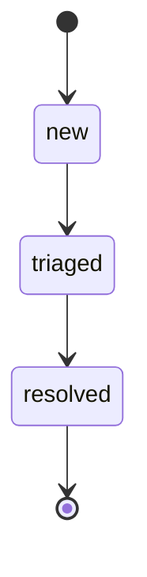

# Atom files

A declarative atom is a `*.atom.md` file with YAML frontmatter and Markdown
instructions, or a `*.atom.mdx` file in the
[JSX-style form](#the-jsx-style-form). [Your first atom](../getting-started/first-atom.md) is a complete
introductory example.

## Fields

| Field | Default or requirement |
| --- | --- |
| `atomic` | Required; format version `1` |
| `description` | Required; one sentence describing the task |
| `name` | Filename stem; set explicitly to preserve identity across a rename |
| `version` | `1`; distinct from the format version and recorded content hash |
| `kind` | `codex`; `lite` and `exec` are additional initial kinds |
| `input`, `output` | Required contracts, inline or discovered from sidecar files |
| `model` | Resolved provider/model configuration; override when the task needs it |
| `codex` | Proposed Codex config passthrough, constrained by managed requirements; e.g. [`web_search`](../guides/web-search.md#choose-a-search-mode). Supported keys are checked against the pinned runtime |
| `sandbox`, `network` | Read-only and no shell network for atoms; write access must be declared. `network.allow` lists the hosts a step may reach |
| `runtime` | The toolchain an atom's code needs, such as `deno` · v0.7 |
| `env` | The environment an atom's own code receives: literals and `{ secret: <name> }` references. Never given to a model's shell · v0.7 |
| `credentials` | A named credential from the manifest, such as an AWS role. Atomic issues short-lived keys for it when the step is dispatched · v0.7 |
| `tools` | Optional allowlists for Atomic, OpenAPI and MCP tools permitted by policy |
| `validate` | CEL rules over input/output, all required to pass |
| `evals` | [Case directory](eval-cases.md); defaults to `<manifest-dir>/evals/<resolved-name>/`; an explicit path is atom-relative |
| `budget` | [Token, active-time and priced-cost limits](budgets.md), inherited when omitted |
| `retry` | Bounded retry policy from resolved configuration |
| `approvals` | `attended` forwards live permission requests; `unattended` declines them; distinct from durable gates |
| `effects` | Code or a shell that reaches an outside system declares `effects.external`: `read-only`, or `idempotent` for a write that is safe to repeat; see [durability](../concepts/durable-execution.md). From v0.5, also the mutating operations a run may request, each with a cap; see [tools and integrations](../guides/tools-and-integrations.md#keep-external-effects-explicit) |
| `trust` | Accepted input origins, constrained by project/managed policy; external-origin controls arrive in v0.5 |
| `extends`, `review`, `skills` | Optional reuse, review and skill configuration; availability varies |

Avoid copying a default into every file. Explain an override in the task's
purpose or project convention when the reason would otherwise be unclear.

## Schema locations

Small atoms can keep schemas inline. To keep instructions shorter, place these
files beside `summarize-note.atom.md`:

```text
summarize-note.atom.md
summarize-note.input.schema.yaml
summarize-note.output.schema.yaml
```

A schema file is YAML by default, so it reads like the inline form:

```yaml
# summarize-note.input.schema.yaml
type: object
additionalProperties: false
required: [text]
properties:
  text: { type: string, minLength: 1, maxLength: 4000 }
```

A `.schema.json` file is accepted too, for schemas that come from another tool.
Having both forms for one schema is an error. YAML schemas are limited to what
JSON can express: only `true` and `false` are booleans, so quote words such as
`yes` and `no`, quote regular expressions, and do not repeat a key. Fixtures and
typed examples remain JSON because they are data.

### The compact form

For simple shapes, an inline schema can use a compact form, planned for v0.5:

```yaml
input:
  subject: string, the ticket's subject line
  body: string, the customer's message
  plan?: string, the customer's plan when known
output:
  queue(enum, the team that should handle it): [billing, bugs, account, other]
  urgent: boolean, true when the customer is blocked from working
```

| Write | Meaning |
| --- | --- |
| `name: type, description` | A required field; types are `string`, `integer`, `number`, `boolean` and `any` |
| `name?: type` | An optional field: it may be omitted, and it may not be `null` |
| `tags(array): string` | A list; put nested fields under it for a list of objects |
| `address(object):` | A nested object, with its fields indented below |
| `status(enum): [open, closed]` | One of the listed values |
| `(*): string` | Any other property, of this type |

Fields are required unless marked with `?`, and properties that are not listed
are rejected. Atomic compiles the form to JSON Schema when the project loads;
`atomic schemas expand <atom>` prints the result. The form follows Dotprompt's
Picoschema, except that an optional field is not also nullable. It cannot state
constraints such as `minLength` or `pattern`; write full JSON Schema for those.
See [the example](../../examples/09-compact-and-variants/README.md).

Explicit `input` and `output` declarations override sidecar discovery. Reuse shared
schemas through registered IDs or file references. IDs resolve in the project
registry; schema loading does not fetch arbitrary URLs.

Commit-valued input fields can declare `format: git-commit` alongside their SHA
pattern. For repository-backed runs, the runtime checks those objects exist in
the pinned fixture snapshot before calling a model. This semantic check is
additional to ordinary JSON Schema shape validation.

## Variants

`label-ticket.strict.atom.md` defines variant `strict` of the atom
`label-ticket`. A variant shares the base atom's schemas and eval cases and may
change only its instructions and settings; declaring `input`, `output`, `evals`
or `name` in a variant is an error. Workflows and evals name the variant they
want, and `atomic eval --compare` can compare variants as well as revisions.
Planned for v0.5.

## Instructions and values

The first four rows are the v0.1 tag set. Later tags are marked with their stage:

| Tag | Purpose |
| --- | --- |
| `` | Insert a declared input value with its origin |
| `……` | Include conditional content; `` is optional |
| `` | Include a source-relative prompt fragment |
| `…` | Declare typed JSON input/output examples |
| `…` | Repeat content for each item of a list · v0.5 |
| `…` | Include a fragment with parameters and content for its slot · v0.5 |
| `` | Inside a partial, the place for the content it was given · v0.5 |
| `` | Render a value with the partial bound to its schema · v0.5 |
| `` | Include one symbol or a line range from the step's repository · v0.7 |

Inserted data belongs in the user input, rather than being promoted into static
developer instructions. Conditions and paths are checked against declared schemas
where possible. Each inserted value is wrapped in an element that names its path
and origin and that the value cannot close. From v0.7 an atom can also compute
values in code and read them as `$prepared`; see [code in an atom](#code-in-an-atom).

Lowercase XML-style section tags such as `<rubric>…</rubric>` are allowed in both
forms and reach the model as written. One alone on its line must be closed; in
`.atom.md`, angle brackets inside a line of prose are plain text. Tags starting
with `data-` are reserved for Atomic's value wrapper.

A partial can carry frontmatter of its own: `params` declares the parameters it
takes, read inside it as ``, and `renders` binds it to a schema
ID, with the value read as ``.

## The JSX-style form

A file named `*.atom.mdx` has the same frontmatter and writes the tags as
elements: `{input.text}`, `<If cond={…}>` with `<Else />`,
`<For each={…} as="c">`, `<Partial file="…">`, `<Slot />`, `<Render value={…} />`,
`<File path="…" />` and `<Example>`. Braces
hold CEL; the body is parsed and never executed. A `<` or `{` in prose must sit in a code span.
An atom exists in one form only. Planned for v0.5.

The [template tags guide](../guides/template-tags.md) explains every tag in both
forms, with examples.

## Code in an atom

From v0.7 an atom file can start with a TypeScript block in place of YAML
frontmatter. The form is the same in `.atom.md` and `.atom.mdx`:

````markdown
---ts
import { GetObjectCommand, S3Client } from "npm:@aws-sdk/client-s3@3.1169.0";

export const config = {
  atomic: 1,
  description: "Write a short digest of one operations report stored in S3.",
  kind: "lite",
  network: { allow: ["acme-reports.s3.us-east-1.amazonaws.com"] },
  effects: { external: "read-only" },
};

export async function prepare(input, ctx) {
  const report = await ctx.step("fetch", async () => {
    // read the object with the SDK
  });
  return { report };
}
---
Write a digest of the report.


````

| Export | Purpose |
| --- | --- |
| `config` | The fields YAML frontmatter would hold. A plain literal, read without running the file |
| `prepare(input, ctx)` | Runs before the model call. What it returns is `$prepared` in the body. Each `ctx.step` saves its result, so a retry or a replay reuses it |
| `validate(output, { prepared })` | Checks the output in ways a schema and CEL cannot |

The code runs on Deno, in its own process, with only what the atom declares:
the hosts in `network.allow` and the environment in `env`. It can import any
`npm:` or `jsr:` package that is pinned to an exact version and recorded in
`deno.lock`. The body still runs no code. `prepare` is for reading; a write to
an outside system is a separate step.

Schemas work as in any atom: sidecar files beside the atom are discovered, or
`config` can hold `input` and `output`. Each `$prepared` path in the body is
type-checked against what `prepare` returns. `atomic check` never runs the
code; a typed example in such an atom carries a `json prepared` block with the
values to use.

A whole-file form, `.atom.ts`, is planned for the same stage for atoms that are
mostly logic. Its exports beyond those above are not specified yet.

See [call AWS and other services with an SDK](../guides/scripts-and-cloud-sdks.md).

## Diagrams in instructions

A fenced `mermaid` block is allowed anywhere in the body and reaches the model
as text:

````markdown
Only the transitions in this diagram are allowed.


````

Tags are not expanded inside the fence, and the block counts toward the atom's
size estimate. Keep a diagram only when an eval comparison shows it helps; see
[diagrams with Mermaid](../guides/diagrams.md). Support for the fence is planned
with the v0.5 authoring features.

## Exec atoms

Use `kind: exec` for a deterministic transform. Its proposed invocation contract is:

```yaml
atomic: 1
description: Compute an order total in integer cents.
kind: exec
exec:
  command: [python3, tools/total_order.py]
```

The command is a literal argument array with no implicit shell. One JSON value
arrives on stdin; stdout contains one JSON result; diagnostics go to stderr.
A nonzero exit fails the attempt. Input/output contracts still apply and can be
sidecars. An exec atom does not require model instructions.

The pinned project bundle, rooted at the manifest, supplies the working directory.
Writable scratch space is separate. The local example requires Python on the
host; reproducible toolchain images are a later feature.

See [the order-report project](../../examples/03-order-report/README.md) for scripts,
contracts and fixtures, and [availability](availability.md) for later atom kinds.

### A script that needs packages

From v0.7 an exec atom can name a TypeScript file and the Deno runtime in place
of a command:

```yaml
atomic: 1
description: Store one digest in the reports bucket in S3.
kind: exec
exec:
  script: ../tools/put_object.ts
env:
  AWS_REGION: us-east-1
credentials: [aws-digest-writer]
runtime:
  deno: { sys: [osRelease] }
network:
  allow: [acme-reports.s3.us-east-1.amazonaws.com]
effects:
  external: idempotent
```

`exec.script` is relative to the atom file. `env` and the named credential are
the whole environment the script receives. `effects.external: idempotent` says
the script writes and is safe to repeat; Atomic never runs such code in an
eval, a render or a preview. The script imports `npm:` packages pinned in `deno.lock` beside the manifest, and
Atomic builds the command line with permissions taken from this declaration.
See [call AWS and other services with an SDK](../guides/scripts-and-cloud-sdks.md).
