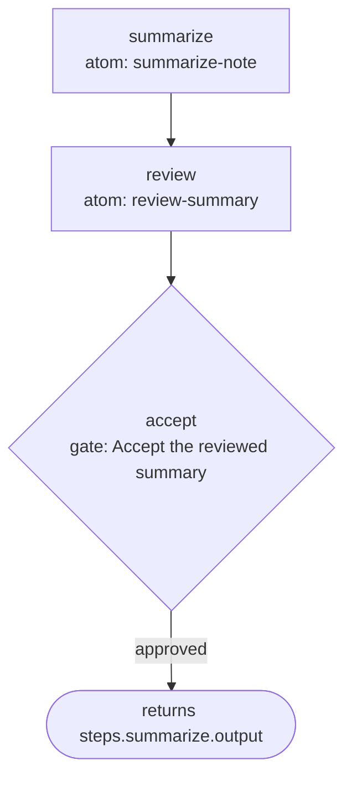

# Workflow files

A `*.workflow.yaml` file declares a typed workflow. The filename supplies its
default name and version defaults to 1. See the
[first workflow tutorial](../getting-started/first-workflow.md) for complete files.

## Top-level fields

| Field | Meaning |
| --- | --- |
| `atomic` | Required format version, currently `1` |
| `name`, `version` | Optional identity overrides |
| `input`, `output` | Explicit workflow contracts: an inline schema, or a `$ref` to a schema file or a registered schema ID |
| `budget` | Optional cumulative [run limits](budgets.md), including child tasks |
| `steps` | Named atoms, gates and other supported operations |
| `returns` | CEL expression for the successful result |

A run records the definitions it starts with. New source edits apply to new runs;
recovery continues against the recorded versions. Use
[`atomic runs resume <run-id>`](../concepts/durable-execution.md#resume-existing-work)
to continue an unfinished run in v0.1.

## Atom steps

```yaml
summarize:
  atom: summarize-note
  with:
    text: input.text

review:
  after: [summarize]
  atom: review-summary
  with:
    source: input.text
    draft: steps.summarize.output.summary
```

`atom` refers to a registered name. `with` maps the target's input fields to CEL
expressions. `after` establishes dependencies; do not depend on YAML key order.
The loader checks required bindings and structural compatibility to the extent
it can prove them.

## CEL values and string literals

An expression such as `input.text` evaluates a value. To produce a literal string,
include CEL's quotes inside the YAML string:

```yaml
title: "'Accept the reviewed summary'"
```

Use CEL for value mappings and validation. Declarative workflows do not execute
arbitrary shell or JavaScript expressions.

## Gate steps

```yaml
accept:
  after: [review]
  gate:
    title: "'Accept the reviewed summary'"
    show: "{'draft': steps.summarize.output, 'review': steps.review.output}"
    timeout: 24h
    on_timeout: reject
```

An omitted `approvers` resolves to the authenticated local operator in local mode.
Shared/team deployments require an approved group from project policy or an explicit
allowed group; missing authorization fails loading. Caller input and model output
cannot select the approver. A rejected, expired or unresolved gate does not
authorize downstream work. Its original wall-clock deadline continues while
Atomic is offline; resume applies expiry before proceeding.

`after: [review]` means the review finished, not that its verdict was `approve`.
Use a review policy or a deliberate human gate to decide what happens next.

## View a workflow as a diagram

In v0.5, `atomic workflows show <name>` inspects the definition. Add
`--format mermaid` to print its diagram:

```sh
atomic workflows show summarize-and-review --format mermaid
```



Each step is a node, each gate a diamond and each `after` entry an edge; the
rounded node is the workflow's result. A
diagram committed in a doc can be marked as generated, and `atomic check` then
fails when it falls behind the file. Add `--view risk` to label each step with
what it is allowed to do, or `--view cost` for its budget. See
[diagrams with Mermaid](../guides/diagrams.md).

## Runtime metadata and later composition

`steps.<id>.output` is the typed result. `steps.<id>.metadata` holds runtime facts,
including a coding candidate's `commit`. Pass that runtime-owned SHA to review;
do not ask the author model to invent it.

From v0.7, `steps.<id>.prepared` holds what the step's atom
[computed in code](atom-files.md) before its model call. Like
metadata, it is not written by a model, so a gate can show it as evidence.

The later workflow language adds `foreach`, concurrency, merge queues and richer
review policy. Every new candidate produced by rebase or conflict resolution
needs checks against its new content. See [availability](availability.md) and
[the advanced recipes](../../examples/recipes.md) before using those features.
