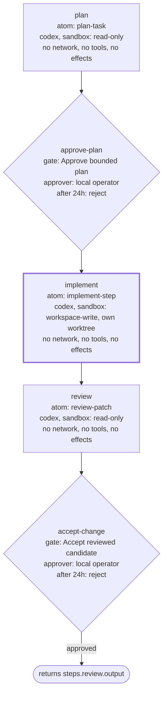

# Reviewed coding change · v0.1

[The workflow](workflows/change-request.workflow.yaml) plans one small change,
waits for local approval, implements it, reviews the candidate and waits for final
acceptance. It never integrates or pushes. Plan and review atoms inherit the
read-only sandbox; only the implementer requests workspace-write.

The implementer returns its summary and actual test commands. The runtime owns
the candidate SHA, exposed as `steps.implement.metadata.commit`. The reviewer
receives that SHA and the immutable base. The final gate shows the SHA together
with the verdict; finishing a review step does not mean it approved the change.
The operator should reject a failing or unsupported candidate.

## What each step may do

The risk view, which the diagram exporters planned for v0.5 would print, shows
that authority at a glance. The one step that can change files has a heavier
border as well as its label, so the difference survives without color:

<!-- atomic:diagram workflow=change-request view=risk -->


The marker above the block names its source; the catalog checker regenerates the
diagram and fails when the committed copy differs. See
[choose a view](../../docs/guides/diagrams.md#choose-a-view).

## Prepare a real repository now

The [curated seed](fixtures/repo/pricing.py) has an intentional quantity bug and a
passing one-unit test. The checked-in all-ones/all-twos SHA values are offline
schema fixtures, not commits. Prepare a separate copy with real commits:

```sh
# From the repository root; choose a new destination.
python3 examples/02-change-request/tools/prepare_fixture.py /tmp/atomic-coding-demo
```

The [helper](tools/prepare_fixture.py) requires Python and Git. It creates:

- `/tmp/atomic-coding-demo/repository`: deterministic `baseline` and deliberately
  incomplete `candidate` commits, with the source left at `baseline`.
- `/tmp/atomic-coding-demo/project`: a copy of this project whose eval inputs and
  matching JSON fixtures contain those real SHAs.
- `/tmp/atomic-coding-demo/fixture.json`: absolute paths and commit identities.

Setup is operator-run, outside model control. It rejects existing destinations
and destinations inside this source workspace. It does not modify this repository,
run a model or execute Atomic. Run it again with a different destination to produce
the same baseline/candidate identities.

## Run when the v0.1 runtime exists

The proposed CLI binds a fixture repository and revision explicitly, even from an
unrelated current directory:

```sh
cd /tmp
atomic --project /tmp/atomic-coding-demo/project eval review-patch \
  --fixture /tmp/atomic-coding-demo/repository --fixture-rev baseline
atomic --project /tmp/atomic-coding-demo/project run change-request \
  --input /tmp/atomic-coding-demo/project/fixtures/plan-task/quantity.input.json \
  --fixture /tmp/atomic-coding-demo/repository --fixture-rev baseline
```

`baseline` resolves to a commit and is pinned at admission. Runtime attempts use
isolated worktrees of a private snapshot, never this fixture's checkout or your
development checkout. `format: git-commit` input fields identify commits the
runtime must verify in that snapshot; base fields must match the selected base.
A missing repository/revision/commit fails setup before a model call. Atomic does
not replace placeholder hashes automatically or run undeclared setup commands.
See [coding fixture binding](../../docs/reference/eval-cases.md#coding-fixture-repositories).

For live acceptance, examine actual test evidence; a nonempty model-generated
`tests_run` list alone proves no test ran. Runtime-enforced executable acceptance
criteria are planned in M47. These CLI commands are not executable in this planning
repository; the fixture helper and offline checker are executable today.
