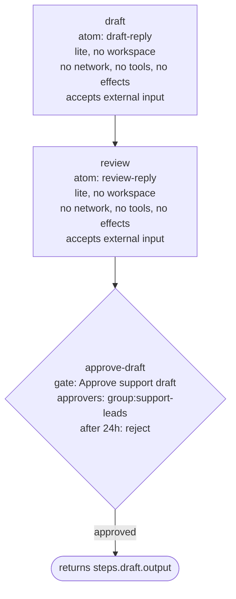

# Support reply with independent review · v0.5

[The workflow](workflows/support-reply.workflow.yaml) drafts a reply from a ticket
and approved policy, runs a separate review atom, then asks `group:support-leads`
to approve the actual draft and verdict. It returns the accepted draft. There is
no send tool, optional MCP server, shell network permission or refund operation.
Both atoms are lite because they only judge supplied text.

`trust: external` accepts the ticket's origin; it does not promote the ticket to
trusted instructions or authorize an admin action. The reviewer receives a fresh
input and the approved policy, not the author's reasoning. Its verdict does not
complete the human gate. A reviewer failure or escalation remains visible to
the approver, who can reject the draft.

The input's `policy` must be supplied by the trusted caller or bound to pinned
project content at ingress. An external caller must not get to set policy just
because the schema accepts a string. The plan still needs a field-provenance and
ingress-binding syntax; this example documents that deployment precondition
instead of inventing one. SSO group mapping is also operator configuration.

## What each step may do

The risk view of the workflow shows each step's authority beside its place in
the flow: neither atom has a workspace, network access, tools or effects, both
accept external text, and the draft waits for `group:support-leads`.

<!-- atomic:diagram workflow=support-reply view=risk -->


The block is what the planned `atomic workflows show support-reply --format
mermaid --view risk` would print, and the marker above it names its source. The
catalog checker regenerates it and fails when the committed copy differs.
Nothing in it depends on color. See
[choose a view](../../docs/guides/diagrams.md#choose-a-view).

## Check and evaluate

Future check/eval commands:

```sh
atomic check
atomic eval draft-reply
atomic eval review-reply
```

The fixtures include an injected refund demand and a reviewer case with a
forbidden promise. They establish schema examples, not measured model quality.
To send the accepted draft later, checkpoint the exact request before dispatch,
use a stable logical operation ID and the effect ledger, and park uncertain
outcomes. Merely adding a human gate is insufficient.
