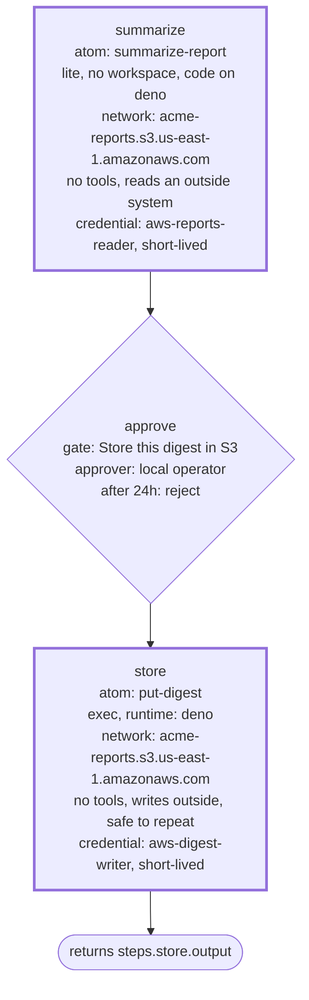

# Read from and write to S3 with the AWS SDK · v0.7

[The workflow](workflows/digest-report.workflow.yaml) reads a report from an S3
bucket, has a model write a digest of it, waits for a person to approve the
digest and stores it back in the bucket. Both S3 calls use the AWS SDK for
JavaScript, imported straight from npm. The model never holds an AWS credential
and never makes an AWS call.

| Step | Atom | What it does |
| --- | --- | --- |
| `summarize` | [`summarize-report`](atoms/summarize-report.atom.md), lite, with code | TypeScript in the atom file reads the report from S3; one model call then writes the digest |
| `approve` | gate | Shows the report's key and the hash of what the model read, beside the digest |
| `store` | [`put-digest`](atoms/put-digest.atom.md), exec | Runs [`put_object.ts`](tools/put_object.ts): creates the digest object, and never replaces one |

## The read lives in the atom

[`summarize-report.atom.md`](atoms/summarize-report.atom.md) starts with a
TypeScript block in place of YAML frontmatter. The block imports the SDK and
exports a `prepare` function, which runs before the model call. Shortened:

````markdown
---ts
import { GetObjectCommand, S3Client } from "npm:@aws-sdk/client-s3@3.1169.0";

export const config = {
  atomic: 1,
  description: "Write a short digest of one operations report stored in S3.",
  kind: "lite",
  network: { allow: ["acme-reports.s3.us-east-1.amazonaws.com"] },
  // env, runtime and effects are in the file
};

export async function prepare(input, ctx) {
  const report = await ctx.step("fetch", async () => {
    const s3 = new S3Client({ /* region and credentials from the environment */ });
    const object = await s3.send(new GetObjectCommand({ Bucket: "…", Key: input.key }));
    return { text: await object.Body!.transformToString() };
  });
  return { report };
}
---
Write a digest of the report…


````

- **`prepare` returns values for the instructions.** The body reads them as
  `$prepared`, the same way it reads `$input`.
- **`ctx.step` saves its result.** A retry or a replay of the run reuses the
  saved report and does not read S3 again. The tests show a replay working with
  no network permission at all.
- **The body still runs no code.** Only the block at the top does.
- **`config` is a plain literal.** Atomic reads it without running the file, so
  it knows what the code may do before any of the code runs.

The code runs on [Deno](https://deno.com/), which resolves `npm:` imports
itself. There is no `package.json`, no install step and no `node_modules`
directory. [`deno.lock`](deno.lock), beside the manifest, records the integrity
hash of the SDK and of every package it depends on.

## The write is a separate step

The digest is written after the gate, so it cannot be part of the atom that
calls the model. [`put-digest`](atoms/put-digest.atom.md) is an exec atom that
names a script:

```yaml
kind: exec
exec:
  script: ../tools/put_object.ts
env:
  AWS_REGION: us-east-1
  REPORTS_BUCKET: acme-reports
credentials: [aws-digest-writer]
runtime:
  deno: { sys: [osRelease] }
network:
  allow: [acme-reports.s3.us-east-1.amazonaws.com]
effects:
  external: idempotent
```

A step runs at least once. If the process dies after S3 accepts a write and
before Atomic saves the step's result, the step runs again. `put_object.ts` is
written for that:

1. It creates the object only if the key is free (`IfNoneMatch: "*"`).
2. If the key is taken, it asks S3 for the stored object's SHA-256 checksum.
3. If the checksum matches the text it was about to write, an earlier attempt
   did the work, and it returns `created: false`.
4. If the checksum differs, it fails and writes nothing.

Within one run the digest is a saved step result, so a repeated `store` step
writes the same text and succeeds. A second run for the same report produces a
new digest, and `store` refuses to replace the first one. Replacing a digest
is a different operation and would need its own atom and its own approval.

The gate authorizes the write. It does not make it safe to repeat; the script
does.

## Both atoms declare what their code may do

The same fields apply to the block and to the script:

- **`env`** is the whole environment the code receives, apart from what a
  credential adds.
- **`credentials`** names a credential defined in [the manifest](atomic.yaml).
  Each is an AWS role. When a step is dispatched, Atomic assumes the role and
  gives that step keys that expire in minutes. No long-lived key is stored, and
  none reaches a file, a checkpoint or a model's context.
- **`network.allow`** lists the hosts the code may reach. The SDK addresses a
  bucket by its own host name, so each atom can reach one bucket and nothing
  else.
- **The bucket is configuration, not input.** A caller chooses a key, which the
  input schemas limit to `reports/` and `digests/`. A caller cannot choose a
  bucket.
- **`effects.external`** tells Atomic that the code reaches a system Atomic
  cannot observe. The atom that reads says `read-only`. The script that writes
  says `idempotent`: it changes something, and running it again is safe.
- **Reading and writing use different credentials.** Give the reader role
  `s3:GetObject` on `reports/*`, and the writer role `s3:PutObject` and
  `s3:GetObject` on `digests/*`.

The gate shows `steps.summarize.prepared.report.sha256`. A workflow can read
what a step's code prepared, so the approver sees the hash of the exact text
the model was given.

Nobody writes Deno's permission flags by hand. From the declaration, the
command Atomic would run for the script is:

```sh
deno run --no-prompt --lock=deno.lock --frozen --cached-only \
  --allow-net=acme-reports.s3.us-east-1.amazonaws.com \
  --allow-env=AWS_REGION,REPORTS_BUCKET,AWS_ACCESS_KEY_ID,AWS_SECRET_ACCESS_KEY,AWS_SESSION_TOKEN,HOME \
  --ignore-env --no-remote --allow-sys=osRelease \
  --allow-read=<project> --allow-write=<scratch> \
  tools/put_object.ts
```

`--no-prompt` turns a missing permission into an error. `--frozen` fails the
run if the lockfile would have to change, and `--cached-only` means packages
were fetched earlier, in a setup step whose network reaches only the package
registry. `--allow-env` names exactly the variables the atom declares, plus
`HOME`, which Atomic points at the step's scratch directory; `--ignore-env`
makes any other lookup return nothing, which is what the SDK needs when it
probes for settings it was not given. `--no-remote` forbids modules loaded from
a URL. `--allow-sys=osRelease` is there because the SDK puts the operating
system's version in its user agent. The code may read the project and write
only the step's scratch directory. The atom's code block
runs the same way, from a module Atomic generates.

The risk view of the workflow shows the result:

<!-- atomic:diagram workflow=digest-report view=risk -->


## Project-wide settings

[The manifest](atomic.yaml) tightens two defaults for all the code in this
project:

```yaml
runtime:
  deno:
    minimum_dependency_age: 2d            # default 1d
    allow_packages: ["npm:@aws-sdk/*"]    # default: any pinned package
```

A release must be two days old before it can be locked, and atom code may
import only AWS SDK packages. See
[security defaults and settings](../../docs/guides/atom-code-runtime.md#security-defaults-and-settings).

## Run the code now

The code is real and tested. [`test/atom_test.ts`](test/atom_test.ts) runs the
atom's `prepare` and [`test/scripts_test.ts`](test/scripts_test.ts) runs the
write script, each as a separate process with the restricted permissions above,
against [a small local stand-in for S3](test/fake_s3.ts). Atomic is planned to
download and manage its own Deno, and `atomic deno test …` would run these
tests with it. Until Atomic exists, use a Deno 2 you installed, from this
directory:

```sh
deno test -A --lock=deno.lock --frozen test/
```

`atomic test` would run them with network access limited to this machine, so a
test cannot reach a real service. They pass that way today:

```sh
deno test --no-prompt --lock=deno.lock --frozen --allow-net=127.0.0.1 \
  --allow-run --allow-read --allow-write=/tmp --allow-env=DENO_DIR test/
```

The tests need no AWS account and send nothing to AWS. They check that:

- The atom's code type-checks, and every `$prepared` path in its instructions
  exists in what `prepare` returns. A path it does not return is a type error.
- The workflow reads only prepared values the atom returns.
- `prepare` returns exactly
  [the committed sample](fixtures/summarize-report/october.prepared.json).
- A replay with the saved step result runs no step and sends no request, with
  no network permission.
- `put-digest` returns [its fixture output](fixtures/put-digest/october.output.json),
  writes once when repeated, and refuses to replace different content.
- Neither the block nor the script can reach a host its atom did not declare.
- With no test endpoint, the SDK asks for
  `acme-reports.s3.us-east-1.amazonaws.com`, the host the atoms declare.

All eleven passed on Deno 2.9.8 with `@aws-sdk/client-s3` 3.1169.0. The code has
not been run against a real bucket, and the stand-in's ETag is not computed the
way S3 computes one.

[`test/atom_host.ts`](test/atom_host.ts) stands in for Atomic: it splits the
block from the atom file, generates the module that calls `prepare`, and
supplies the `atomic:std` and `atomic:types` modules from
[`test/atomic/`](test/atomic/std.ts).

## Run the workflow when Atomic exists

Future commands, from this directory:

```sh
atomic runtimes lock
atomic check
atomic run digest-report --data '{"name": "2026-10.md"}'
atomic run atoms/summarize-report.atom.md --data '{"key": "reports/2026-10.md"}'
```

The first writes `deno.lock` from the imports in the atom and the script. The
third runs the workflow by name. The fourth runs one atom by the path to its
file, which also works from outside the project.

## What is not settled

- **Spellings.** The `---ts` block and its `config`, `prepare` and `ctx.step`,
  the fields `exec.script`, `env`, `credentials`, `runtime.deno`,
  `network.allow` and `effects.external`, the manifest's `credentials` block,
  `steps.<id>.prepared` and `atomic test` follow the plan and may change. So
  may the names in `atomic:std` and `atomic:types`.
- **Role assumption is untested.** The tests hand the code fixed test keys, as
  the broker would hand it short-lived ones. Nothing here calls AWS to assume a
  role.
- **Large objects.** The report passes through a saved step result and is
  capped at 200 kB. Larger files belong in the planned typed file inputs and
  outputs.
- **Reports from outside the team** would need the external-origin controls
  planned for v0.5.

`put-digest` has no eval cases. Atomic never runs code that declares a write
as part of an eval, a render or a preview; such code is covered by tests like
these. [The summarize case](evals/summarize-report/october.yaml) carries a
`prepared` value, so that eval reads nothing from S3.

The catalog checker does not run Deno. It reads the block's `config` without
running the file, and checks that every package import is pinned and recorded
in the lockfile, that the atoms declare their hosts and effects, that no
credential is written as a value and each named credential is defined in the
manifest, that the instructions and the workflow use only `$prepared` paths
present in the committed sample, that the eval case's `prepared` value equals
that sample, and that the atom whose code writes has a test and no eval case.
